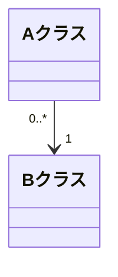
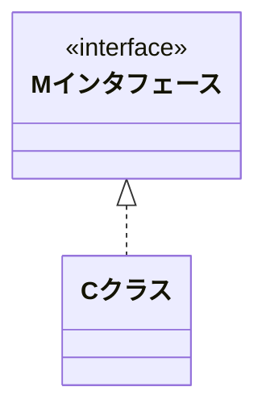
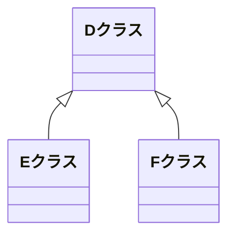

### オブジェクト指向を上手に活かすために

ここに書いたのは、私が設計・実装したJavaのフレームワーク開発を主に通じて理解したオブジェクト指向の原理原則です。  
私は単なるエンジニアであって学者や研究者ではない上に、オブジェクト指向について誰かから教わった経験も無いため、ここに書いてある内容は科学的に吟味されたものではありません。  
しかし、普段の仕事の中で気付いた合理性のある内容だと考えています。オブジェクト指向言語を日常使ってはいても、オブジェクト指向そのものをみっちりと学習したことがない人にとって特に役立つ内容だと思います。

## オブジェクト指向って?

オブジェクト指向の最初の説明として良く出てくるのが、

-   隠蔽
-   継承
-   多態性

というものです。 これらはオブジェクト指向の特徴を確かに言い表していますが、オブジェクト指向的な設計や実装を初学者が理解するための役に立たないとytpは考えています。少なくとも初心者にとっては百害有って一利無しです。  
これから説明するオブジェクト指向に関する原則は、実際の開発現場で皆さんが実践することを目的に書いています。つまり、

-   開発現場で役立つオブジェクト指向の本質を解き明かす

ために書きました。

オブジェクト指向設計に関しては**デザインパターン**という形で様々な本が書かれていますが、パターンは有用ではあるものの全部を一々覚えてはいられません。そもそもパターンというのは、オブジェクト指向の本質を理解した人が設計した有用な常套手段に名前を付けたものです。

-   パターンは囲碁で言う**定石**

です。しかし、

-   定石には必ず理由があり、それらの根底には**共通する原理原則**がある

のです。  
このサイトでは、オブジェクト指向設計における原理原則を記述しています。つまり、

-   定石を産み出すための原理原則

です。囲碁で言えば**手筋(てすじ)**が近いでしょうか。  
これを理解してしまえばパターンのみに頼ることなく正しい設計にたどり着けると私は考えています。しかしパターンを否定しているのでは決してありません。

-   パターンの奥に隠れた**本質(原理原則)を理解する**

ことが大切だと考えています。

### オブジェクト指向の利点

オブジェクト指向で開発すると何がいいのでしょうか? 一言で言うと、

-   1箇所直せばみな直る

です。  
実はオブジェクト指向は、最初にコードを書く時の生産性は手続き型に較べて低いのです。しかし、

1.  開発中あるいは開発後に仕様変更または仕様ミスがあって修正する
2.  別のシステムでの部品を流用する

ような場合に威力を発揮します。つまり、

1.  保守性が高い
2.  再利用性が高い

という特徴があるのです。  
そのため、

-   徹底したオブジェクト指向で開発されたシステムは総合的な生産性が高い

と言えます。

### オブジェクト指向はなぜ難しいか

特に最近は関数型指向と言って手続き型へ回帰するほど、オブジェクト指向を回避する傾向が見られます。  
オブジェクト指向はなぜそれほど難しいのでしょうか?  
いくつか理由は考えられますが、以下の3点が大きいのではないかと思います。

1.  顧客から要求されるのは処理であってデータ構造ではないため、データ構造を正しく定義出来ないから。
2.  オブジェクト指向言語は手続き型言語の延長線上にあり、手続き型でも書けてしまうから。(特にJavaの場合は)
3.  RDBとの相性がとても悪く、筋の悪いO/Rマッパーを使うと処理とデータ構造が分離されて結局手続き型になってしまうから。  
    この相性の悪さをインピーダンスミスマッチと言います。どう対応すればいいのかを[関数とユーティリティクラスは禁止](7_%20関数とユーティリティクラスは禁止.md)で詳しく書いています。  
    

オブジェクト指向をきちんと理解できていない人が雑誌やWebなどで誤った説明をしているのを見るのはとても複雑な気持ちです。悪気は無いのでしょうが、うまく使いこなせない人を増やす結果になっています。  
そのような人たちは次の点をまず理解して欲しいと思います。

-   処理ではなく、データ構造をまず共通化する。  
    [privateメソッド禁止](8_%20Privateメソッド禁止.md)で詳しく書いています。

### クラス図の読み方

このサイトでは、UML(Unified Modeling Language)のクラス図(Class Diagrams)がたくさん出て来ます。ご存じない人のためにその読み方を簡単に説明します。次の3つがあります(UMLの定義ではこれ以外もあります)。

1.  関連
2.  実現
3.  汎化

#### 関連

「独立したAクラスとBクラスがお互い相手を参照する」という関係を表します。「バイク本体とタイヤ」のような関係です。タイヤはバイクの部品ですが、あるタイヤを色々なバイクに取り付けることが可能です。

-   このバイクの部品として使っているタイヤ
-   このタイヤを利用しているバイク

という双方向の関係が成立します。  
関連を記述する場合は

-   多重度(カージナリティ:cardinality)

を省略してはいけません。これが記述されていないと、そのモデルが扱う業務の目的を理解できないからです。

#### 実現

「Mインタフェースの振る舞いをCクラスが具体化(実装)している」という関係を表します。振る舞いの型(呼び出し名、パラメータ、戻り値)だけをインタフェースでは定義し、その具体化(実装)はCクラス側に任せます。

-   インタフェースは「役割」

と理解して下さい。  
例えば自動車と飛行機の役割は「乗り物」です。この場合、乗り物インタフェースを実現(実装)する形で自動車クラスと飛行機クラスを設計します。

#### 汎化

「EとFの性質の共通部分を抜き出してDとした」関係のことです。例えば「ワゴン車とセダンを自動車と呼ぶ」という関係です。「継承」とも呼ばれます。

-   ワゴン車は自動車を継承している。

また「**is a の関係**」とも言われます

-   E is a D.
-   ワゴン車は自動車である。(自動車として扱える)

### 集約は使わない

UMLの産みの親「Three Amigos」の一人であるジム・ランボーは、

-   集約はプラセボ(プラシーボ)効果である

と言いました。つまりその効果は「気のせい」で、有用性は無いという意味です。  
最近まで私は**関連**を使わずに**集約**のみで書いていたのですが、色々迷って考えた結果この逆の結論に至りました。モデルを表現する際、集約は紛らわしさを助長します。  
集約は「has a」の関係と言われ、

-   AクラスがBクラスを持つのか?
-   BクラスがAクラスを持つのか?

によって菱形を付けるクラスが入れ換わりますが、関連があるクラス同士は双方向で参照するため、

-   どちらも相手を持てる(持つ必要がある)

という結果になるのです。そのため集約は意味を成しません。

### このサイトを読む上での注意点

このサイトに書いてある内容には、皆さんのこれまでの常識をくつがえすものが多々あります。今までの常識にとらわれずに読んで下さい。可能ならば頭を白紙の状態にして、書いてある内容を純粋に吟味してみて下さい。皆さんの開発にきっと役立つはずです。

それでは次ページから、「本には書いてないオブジェクト指向」の始まりです。
