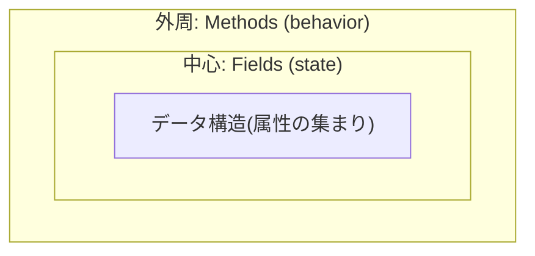
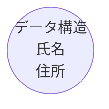
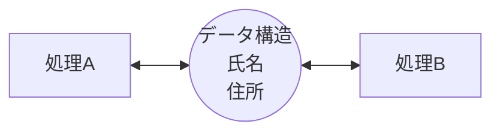
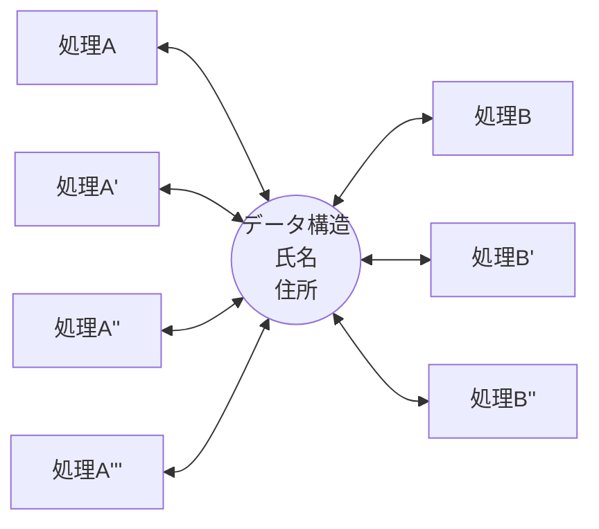
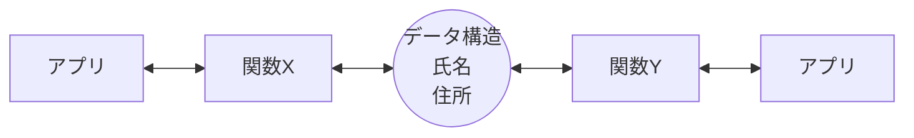
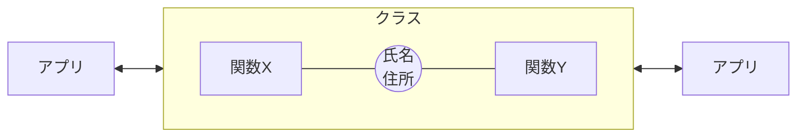

### クラスを見つけるのがオブジェクト指向設計

オブジェクト指向にはクラスが必要です。オブジェクト指向的に設計しようとすることはクラスを見つけることに他なりません。

### AクラスとBクラスが異なるクラスとして必要な理由は何?

クラスを見つけるというのはつまりクラスを定義することですが、では、AクラスとBクラスという2つの異なるクラスが必要になる時の理由は何でしょうか?

1.  処理が異なる
2.  責務が異なる
3.  データ構造が異なる

正解は「**3.データ構造が異なる**」です。  
クラスの根本は、

-   データ構造(構造体)とそれを扱う処理(関数orメソッド)を一体化させたもの

です。  
データ構造というのは属性(プロパティ)の集まりのことで、それら属性の値を読んだり編集したりするために処理は存在します。

次の図はOracleのJava入門のページに書いてあるものです。出典: [What Is an Object?](What%20Is%20an%20Object_%20%28The%20Java™%20Tutorials%20_%20Learning%20the%20Java%20Language.md)



Fieldsというのがデータ構造のことで、その周りを処理(Methods)が取り巻いています。この図は、クラスを基に生成されたオブジェクトの概念を書いたものですが、オブジェクトの設計図となるクラスの定義も同様な考え方です。  
この図からも解るように、

-   データ構造を持たないクラスはそもそもクラスとして機能しない

のです。データ構造と処理の一体化というクラスの原理に反するからです。

### クラスの成り立ち

手続き型の時代から、オブジェクト指向のクラスがどのようにして生まれたのかを見ていきます。

```
手続き型の言語においても共通するデータ構造(構造体)を最初に決めます。
```



```
次に処理(関数)を作成し、処理と処理がデータ構造を受け渡す形で
ロジックを組み立てます。
```



```
ところが似たような処理があちこちに意図せず作成されてしまいます。
```



```
これを避けるために処理を共通化して共通関数を作成し、共通関数のみを
利用するような開発ルールを設けます。しかし仕組みとしての強制力がないため、
似たような関数が複数生まれる危険性は変わりません。
```



```
この危険性を取り除いたのがオブジェクト指向でのクラスです。データ構造が
共通関数を持つように仕組みとして強要します。
```



### クラスの中核はデータ構造

上記で見たように、クラスの最初に必要なのは

-   共通化されたデータ構造

です。  
共通関数というものを開発したことのある人は解ると思いますが、

-   関数(処理)を共通化するためには受け渡されるパラメータをまず共通化する

必要があります。パラメータが複数ある場合、それらをひとかたまりにまとめるとデータ構造(構造体)になります。  
つまり手続き型の言語においても、

-   処理を共通化する前にデータ構造を共通化

していたのです。クラスにおいては、

-   共通化されたデータ構造が処理も持てる

ようになっています。

-   そのクラスを基にした個体(インスタンスあるいはオブジェクト)をメモリ上に複数生成

出来ます。これがオブジェクト指向の原理です。

### まとめ

-   クラスを規定するのは処理ではなくデータ構造

### コラム

「クラスとはデータ構造のこと」と社内の若手プログラマー達に教えています。  
正確に言うと「データ構造と処理を一体化したもの」なんですが、クラスを見分ける際に最初にやることはデータ構造を考えることなので上記のように繰り返し言っています。 にもかかわらず彼らは処理に目が行ってしまい、手続き型の考えにすぐなってしまいます。  
これが人間の本能なのかは判りませんが、プログラマーはそれに陥りやすいと思って設計者は設計する必要があるようです。 つまり曖昧な言葉による表現は避け、きちんとしたクラス図を書いて依頼し、プログラマー任せの製造は避けるべきだと考えています。  
またプログラマー達がコードのみで考える状態から脱却するため、早いうちからクラス図の読み書きを修得するよう指導することも重要です。

次: [責務はクラスではない](3_%20責務はクラスではない.md)
