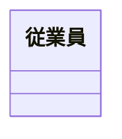
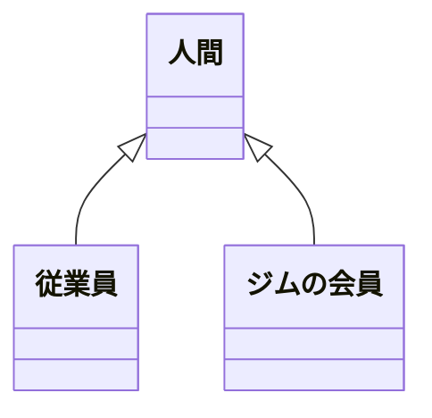
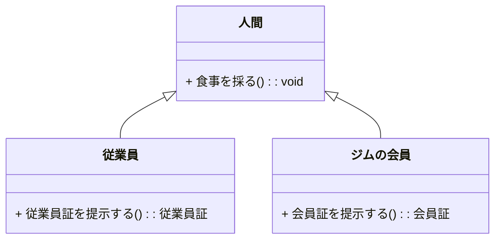
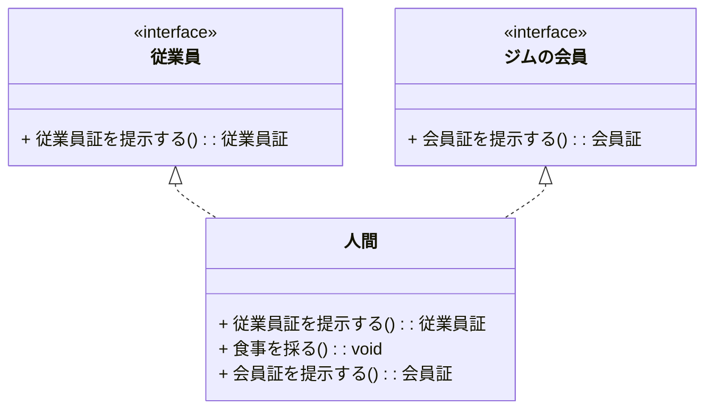
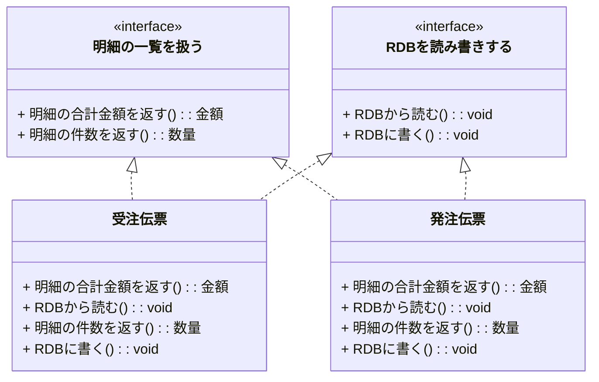

### 責務でクラスは決まらない

「責務」によってクラスが定義されるといくつかの解説書には書いてありますが、これは誤りだと私は考えています。誤りが言い過ぎだとしても、大きな誤解を与えています。  
責務という言葉を言い換えると

-   しなければならないこと
-   出来なければならないこと

となります。クラスを利用する側から見るとそのクラスが何を出来るか(してくれるか)は確かに重要です。  
しかしそれはクラスを使う側から見た場合であって、設計する人はそれだけではクラスを定義出来ません。一つ例を出します。

### 「ジュース売り」という責務

「ジュース売り」という責務を考えてみます。  
ジュース売りがしなければならないのは次のような事です。

1.  注文を聞く
2.  金額を伝える
3.  お金をもらう
4.  品物とお釣りを渡す

では、この責務を請け負えるモノは何が考えられるでしょうか?

### ジュース売りを請け負えるモノ

-   人間
-   自動販売機

ジュース売りを請け負えるモノとして少なくともこの2つが考えられます。将来的には「ロボット」も入ってくるかもしれません。  
ジュースを買いたい購買者側から見れば、それが人間だろうが自販機だろうが要件は満たされます。つまり責務が決まったからと言ってそのモノまでは決められないのです。  
これは当然で、「何が出来るのか」というのは処理の規定であって、データ構造、つまりそのモノの状態は関係無いからです。  
Javaなどでは「Interface」として定義するのが責務です。Interfaceはメソッドを規定するだけで中身は実装者任せです。まさに、「責務は決めるがモノは決めない」という機能です。ちなみに私は

-   Interfaceのことを**役割**と呼ぶ

ようにしています。このページでは責務と役割を同義として書いています。

### 責務で考えると誤ったクラスが出てくる例

従業員を考えてみます。業務システムを設計する際に「従業員クラス」というのは良く出て来ます。  



また、スポーツジムの管理システムを設計すると「ジムの会員クラス」もあります。  


これらをある1人の人の視点から見るとクラス図は次のようになります。  



継承を使ってオブジェクト指向っぽい設計図になったように見えますが、果たして本当にそうでしょうか?

次の図で考えてみます。  



人間を継承する形で従業員とジムの会員を定義すると「食事を採る」という処理が継承されますが、従業員とジムの会員の振る舞いとして考えた場合これは不要です。このような矛盾がなぜ起きたのでしょうか?  
よく考えてみるとこれらの中でモノと呼べるのは人間だけです。従業員やジムの会員は、その人がその時その時に負っている役割に過ぎません。責務と言い換えてもいいでしょう。会社の中で負っているのが従業員という役割、ジムに行けば会員という役割に変わりますが、実体としては同じ人です。

これを正しいクラス図にすると次になります。  



人間の役割としての従業員とジムの会員をinterfaceとして定義します。それぞれの役割を負っている時だけその役割に必要な振る舞いのみを外部から利用出来ます。これで矛盾は解消されます。

人事システムを設計する際に「ジムの会員」という役割を考慮する必要は現実にはないと思います。人事システムから見れば「人間=従業員」という構図は成り立つので、従業員をクラスとして定義することは人事システム設計上正しいと思います。  
しかしそれはシステム設計上便宜的に行っている省略であることを忘れてはいけません。役割(責務)をクラスと勘違いした結果の上記のような誤った設計/実装を大変多く見かけます。

### 責務をもう少し掘り下げてみる

責務というのは英語の'responsibility'の訳です。通常の訳では「責任」です。  
オブジェクト(またはクラス)が持つ責務として世間で見かける解説には、

1.  業務に必要な処理のこと
2.  オブジェクトが持っている情報を通知すること

と書いてあります。  
ジュース売りの例の中で業務に必要な処理というのは「注文を聞く」などです。これはその通りそのクラスが負うべき責務です。しかしそのクラス(もの)が何であるか、つまりデータ構造を規定できないことは上記で書いたとおりです。  
「オブジェクトが持っている情報を通知すること」は内部にデータ構造がないと不可能なので、データ構造に依存するかのような説明に見えます。しかし、情報を通知するというのはどんなオブジェクトにも必要な処理であって、特定の役割とは無関係です。これをオブジェクトの責務と呼ぶのは勘違いだと私は考えます。オブジェクト指向においてオブジェクトに与えられている機能と言うべきでしょう。  
責務というのはそのクラスがシステムの中で果たすべき役割のことであって、仕組みとして備わっている機能のことを呼ぶべきではないと言うのが私の考えです。責務はやはり処理を規定するだけでデータ構造には依存しないのです。

### 単一責務の原則はおかしい

1クラス1責務という原則が提唱されていますが、上記の人間クラスの例を考えてもこれはおかしいのではないかと考えています。  
私が読んだサイトには次のように書いてあります。[www.oodesign.com - Single Responsibility Principle](http://www.oodesign.com/single-responsibility-principle.html)

```
This principle states that if we have 2 reasons to change for a class,
we have to split the functionality in two classes.
Each class will handle only one responsibility and on future if we need
to make one change we are going to make it in the class which handle it.

「クラスを変更する理由が2つある場合は機能を2つのクラスに分割すべき」というのが
この原則です。それぞれのクラスは1つだけの責任(責務)を負い、将来変更が必要になった
時にその責任を負うクラス内で変更を行います。
```

前々項で書いたように「人間」は複数の役割を負うことがあります。それと同じようにシステム設計の中で見つけたクラスが複数の役割を負うことはよくあることです。  
ある一つの役割が負うべき機能や処理が増えた場合、その役割(interface)だけを変更した上で、役割を請け負っている実体つまりクラスを変更します。同じクラスが別の役割も負っている場合はその役割の変更に応じて再度修正すべきです。  
例えば受注伝票と発注伝票というクラスを考える場合、それぞれが明細の一覧を持ちます。「明細の一覧を扱う」という業務的な役割です。この役割には、

-   明細の合計金額を返す
-   明細の件数を返す

などの処理が考えられます。  
一方で、これらの伝票をRDBに保存したいような場合は「RDBを読み書きする」というシステム的な役割も負います。

-   伝票をRDBに書く
-   伝票をRDBから読む

などが考えられます。  



「明細の一覧を扱う」・「RDBを読み書きする」それぞれの役割において変更が発生すれば、それぞれに対する修正が必要となるのは自明です。  
この例においてRDBを読み書きする役割を別のクラスに分けてしまうとそのクラスはデータを持たない処理だけのクラスになってしまい、

1.  データ構造としての伝票クラス
2.  RDBを読み書きする処理のクラス

の2つに結局分割されることになり、データ構造と処理を一体化させるためのクラスという原理から外れてしまいます。  
ただし、同じ伝票クラスの情報を「テキストファイルにも出力したい」という新たな要件が出てくると新たなメソッドを伝票クラスに実装する必要がまた出て来ます。その次はネットワークに出力したい等も考えられ、出力媒体が出てくるたびに処理を追加する必要が出て来ます。この問題への対応は別ページで書きます。

### みんななぜ間違うのか?

世間ではクラスと思われているものが実は誤りである。なぜそうなってしまうのでしょうか?  
クラスを設計する際、その基となるのは顧客からの要求です。要件と呼ばれます。この要件は、

-   システムでxxxがしたい
-   システムを使ってmmmが出来るようになりたい

という実務処理の記述です。裏返すと、

-   システムはxxxが出来なければならない
-   システムはmmmというサービスを提供しなければならない

となります。つまりシステムの役割・責務を列挙したものです。  
役割というのは上で書いたように処理に過ぎません。クラスとして必要なデータ構造はそれだけでは出て来ません。  
しかし、オブジェクト指向に不慣れな設計者・実装者はその要件(処理)だけを頼りに開発してしまいます。

-   データ構造を考えずに処理だけを追いかけてしまう

のです。これが誤りの根本です。

### まとめ

-   役割(責務)をクラスにしてはいけない
-   役割はInterfaceにする
-   要件だけに着目してもクラスは見つけられない

### コラム

責務という言葉の解釈によってこのページで書いたことは変わってくるとは思っています。つまり責務という意味の中に

-   データ構造を持つことを含むかどうか

です。  
データ構造を持つこと自体はクラスとしての機能であって特定の目的のために定義したものではありません。クラスを決めるための責務に機能自体を含めるのは私の感覚にはハマらないのです。  
「責務」あるいは「責任」以外の意味がresponsibilityという英語にひょっとしてあるのかも知れません。そのモノの状態を含むというニュアンスです。私は英語ネイティブではないため判断付きませんが、日常会話で使う場合に「責任」以上の意味で聞こえた経験はありません。仮にモノの状態を含むのだとしても、責務や役割を規定することに頼らずにクラスを設計していくことが出来ます。  
一方で、

-   責務を全うするためにはデータ構造が必要となる

とは言えます。しかしだからと言って、責務を考えた結果だけでデータ構造を導き出せるとは私の経験上思えません。  
責務という言葉が一人歩きして、データ構造と処理を結局分離してしまっているシステムを多数見ています。「すること」に着目してしまっているからです。これは過去の手法への回帰にはなっても、進歩には決してならないと感じています。  
プログラムの開発手法は次のように変遷してきたと思います。この遷移は歴史的検証をしたものではありませんが、大まかにはこうではないでしょうか。

1.  手続き型
2.  構造化
3.  データ中心主義
4.  オブジェクト指向

データ中心主義の時代を経てオブジェクト指向が生まれてきたのに、データ中心で設計するケースが世間では未だに少ないのは非常に残念です。  
「することに着目せずに」クラスを見つけることは出来ます。そのことを次ページ以降に書きたいと思います。

次: [クラスにするもの](4_%20クラスにするもの.md)

