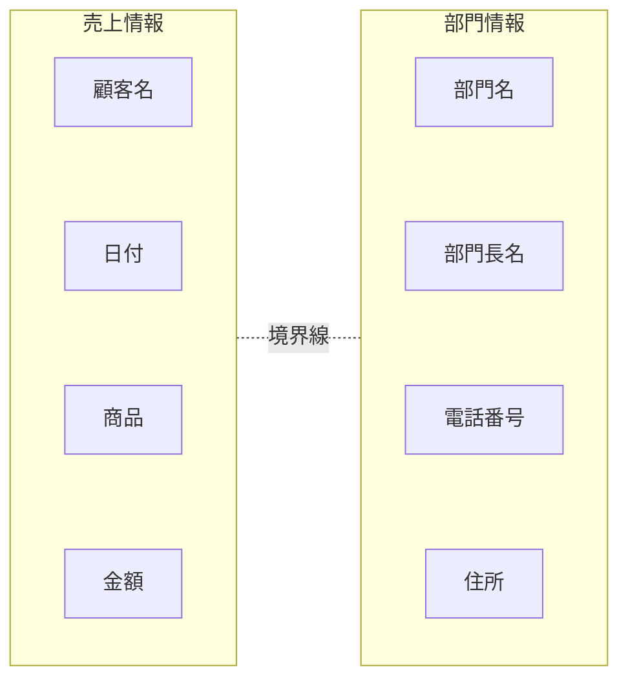
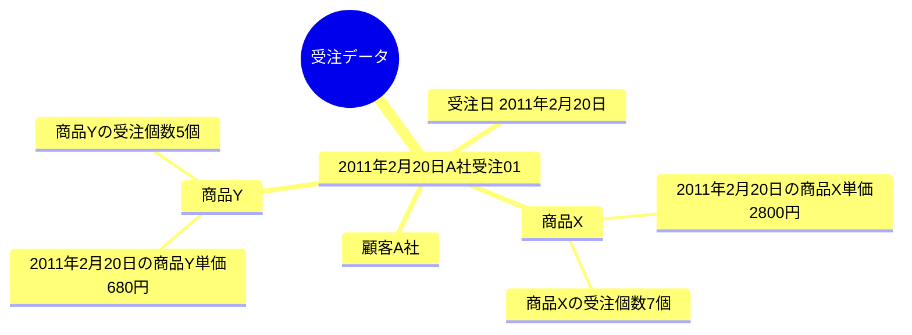
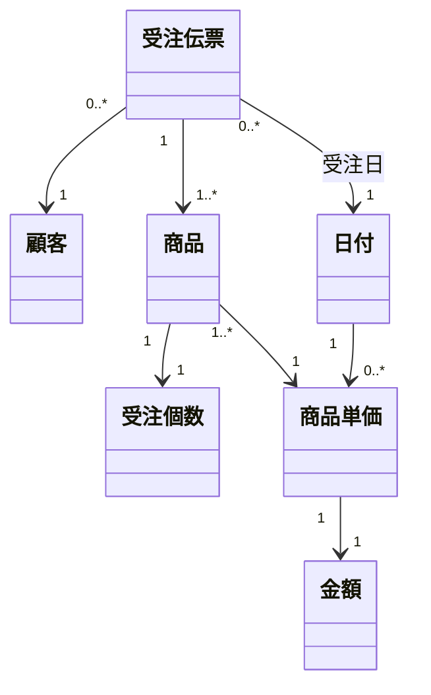
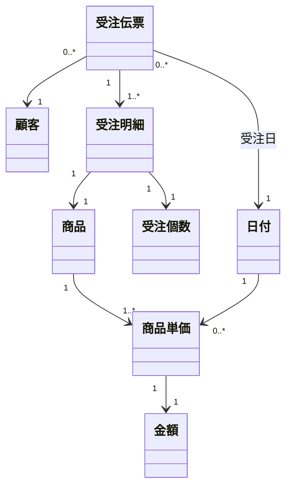
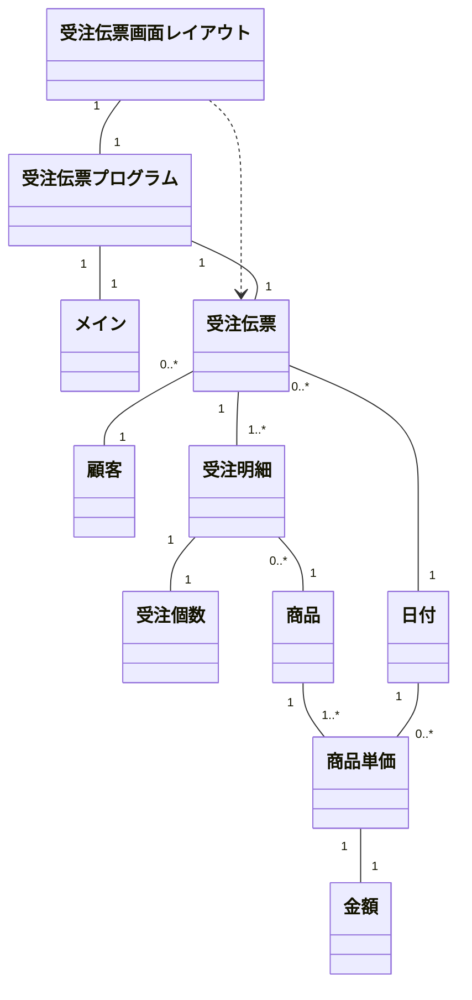

### 役割ではなく、それを実行するための状態を考える

クラスを定義する際にはユーザからの業務要件が基になりますが、それはシステムあるいはプログラム、つまりオブジェクト指向で言えばクラスの役割を規定しているだけです。**役割を規定しただけではモノを決められない**ことは前述の通りです。  
私たち開発者は、その役割を実現出来るモノはどういう状態であるべきかを考える必要があります。なぜならば、

-   状態はデータ構造によって規定される

からです。  
繰り返しますが、その内部の状態がどうなっているかはクラスを利用する側からはあまり重要ではありません。「何をしてくれるのか?」が利用する側からは重要だからです。  
しかしクラスの設計者は、

-   それをするためにはどういうデータが必要か?

を考えて決める必要があります。

### クラスには境界がある

クラスを設計する際に必要なのはデータ構造を考えることです。**データ構造というのは「ひとかたまりとして扱いたい情報」**です。  
AクラスとBクラスを異なるクラスとして定義するということは、Aの情報のかたまりとBの情報のかたまりとの間に**境界がある**ということです。境界がなければ同じクラスでも構わないからです。境界線を引いた上で、境界線の内側にある情報(属性)同士が同じクラスとして扱われるべきです。  

処理に着目してクラスを定義すると、上記のような境界線は見つかりません。2つの処理がある場合、それを1つのクラスにしても2つに分けたとしてもいずれでも実装出来てきてしまいます。2つの処理に明確な境界線は引けないからです。  
しかしデータ構造の場合は人が認識出来る境界線が上記の図のように必ずあります。

### クラスにしてはいけないもの

実際の設計をする上でクラスを考える際、「何をクラスにすべきか」よりも「何をクラスにしてはいけないのか」を考える方が近道です。クラスにしてはいけないのは次のようなものです。

-   ファイル送信クラス
-   データ受信クラス
-   ログ制御クラス
-   メッセージ表示クラス
-   従業員管理クラス

全てに共通するのが**動詞となる名詞が付けられている**ことです。「送信する」「受信する」「制御する」「表示する」「管理する」です。  
動詞になる名詞を持つということはすなわち処理に着目して定義されています。つまりそれは処理を共通化しようとしてクラス化されており、誤っています。**オブジェクト指向において共通化すべきなのは処理ではなくデータ構造**なのです。  
上記の延長線上として、英語の動詞に'er'を付けた名前のクラスも誤りであることが多々あります。

-   Controller
-   Sender
-   Receiver

これらは動詞を無理矢理名詞にしただけで本質は上記と変わりません。そしてこれらは**「役割」を表現することがほとんどで、Interfaceとして定義されるべきもの**を多く含んでいます。

### 物と結果がクラス

それではクラスにすべきものは何でしょうか? システム要件の中に出てくる、

1.  物
2.  結果

の2種類です。

#### 【物クラス】

この種類に分類されるクラスは、実際に存在する物として人間が認識出来るものです。データベースのマスタデータとして分類されるものを多く含みます。

-   商品
-   組織
-   顧客
-   発注先会社
-   通貨
-   日付
-   氏名
-   画面上の座標

#### 【結果クラス】

この種類に分類されるクラスは、人間やシステムが行った結果を記録したものです。商用のシステムの場合は「取引」の結果が中心となります。紙の伝票として書いてあったものは全てこの種類のクラスです。その他に、システムが行った通信の結果を記録したもの(ログ)などもこれに分類されます。  
データベースのトランザクションデータとして分類されるものを多く含みます。

-   受注伝票
-   発注伝票
-   経理仕訳
-   アクセスログ
-   金額

### 受注伝票で考えてみる

商品を受注した時の伝票を考えてみます。(受注時のオブジェクト図)  

上記図中のオブジェクトをまとめると次のクラス図が考えられます。  

このクラス図中では、

-   金額クラスは商品単価の金額値を持つクラス
-   商品単価は「ある特定の日の商品の売り値(金額)」として定義される
-   日付クラスは、受注伝票クラスでも商品単価クラスでも利用される

と定義しています。

ところがこのクラス図には問題となる部分があります。商品が受注個数を持つようになっていますが、受注個数は受注のたびに変わるため、商品の一部としてこれを持つのは無理です。正しくは、

-   「商品/受注個数/商品単価」の組合せとなる結果クラスが必要

です。受注明細と一般的に言われるものです。これを訂正したのが次のクラス図です。  

上記図での注意点は商品単価です。商品単価は、

-   商品
-   日付

の2つの要素によって決まりますが、このモデルでは、

1.  受注伝票が持つ日付
2.  受注明細が持つ商品

によって商品単価を特定します。

### アプリケーションクラス

上記の「物」と「結果」に加えて、アプリケーションプログラムそのものを具現化するクラスが必要です。次の3つがあります。

1.  レイアウトクラス
2.  プログラムクラス
3.  メインクラス

#### 【レイアウトクラス】

-   画面レイアウトクラス
-   帳票レイアウトクラス

画面や帳票のレイアウトを持つクラスです。Webアプリケーションの場合、画面レイアウトを専用に持つクラスがプラットフォームごとに用意されていることがあります。例えばJSPやASPです。  
帳票レイアウトは出力メディアが様々なのでその時々で異なります。例えばExcelやPDF用のクラスを作成する必要があります。  
これらのクラスは「**情報の配置図(レイアウト)**」であり、「物クラス」の性質を持ちます。

#### 【プログラムクラス】

-   画面プログラムクラス
-   帳票プログラムクラス
-   バッチプログラムクラス

画面のボタンが押された時や帳票プログラムが起動された時に、どの物クラスや結果クラスを扱うのかという情報を持っているクラスです。  
例えば入荷実績登録画面上で登録ボタンが押されると、

1.  入荷実績登録プログラムクラスの登録メソッドが呼ばれる
2.  画面レイアウトクラスが持つ入力情報を受け取る
3.  入荷商品ごとに在庫商品の数量を増加させる
4.  入荷予定を消し込む

というふうに、画面の情報を基に複数の結果クラスの状態を変えていく動きをします。  
プログラムクラスはプログラム自身を具現化したものなので、

-   プログラムID
-   プログラム名称

などの属性を持たせます。

#### 【メインメクラス】

アプリケーションが起動される入り口のクラスです。このクラスはメイン関数(メソッド)を持っているだけです。  
メインは関数にならざるを得ないため、この中での処理はログ出力やエラー時の対応など最低限にとどめ、プログラムクラスのインスタンスに早く委譲するようにすべきです。  
メインクラスはアプリケーションプログラム個別に作成する場合と汎用的に一つだけ持つ場合があり得ます。

### アプリケーションのクラス構成

上記で説明したクラスを受注伝票登録画面のアプリケーションとして仕上げる場合、次のような構成になります。 

### まとめ

-   中心となるクラスは「物」と「結果」
-   動詞のクラスを作ってはいけない
-   クラスを抽出する前にオブジェクト図でまず考えてみる

### コラム

「処理がクラスだ」と思っている開発者が大勢います。そう思っていなくても結果的にそういう実装になっている人も多いのです。  
クラスを設計する際は、

-   どんな情報が必要か?
-   どんな状態を持つ必要があるか?

だけをひたすら追求するようにしてみて下さい。あとはそれらの組み合わせ方(関連)を考えるだけです。  
それが出来るようになればきれいな設計に自然に近づきます。

次: [小粒クラス](5_%20小粒クラス.md)

