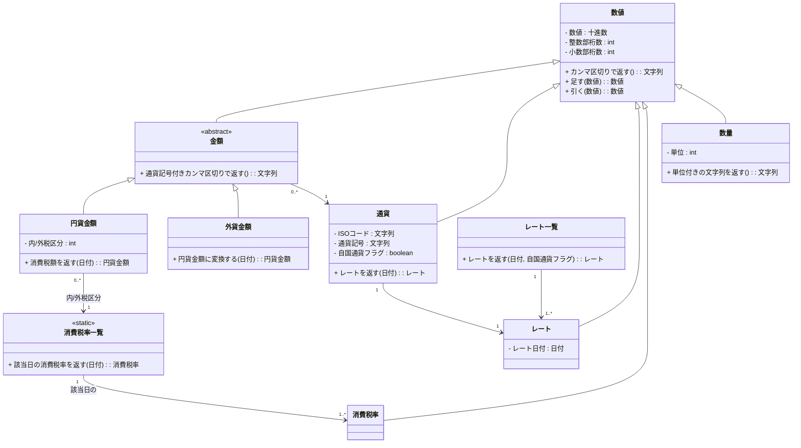
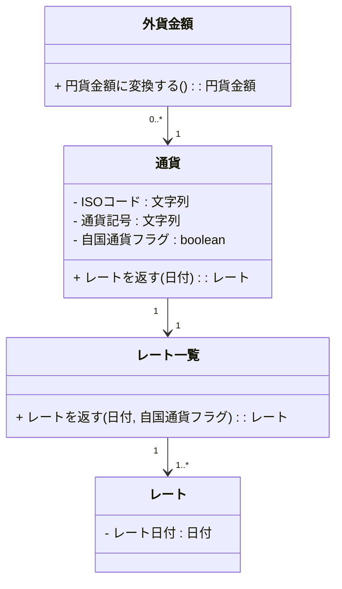
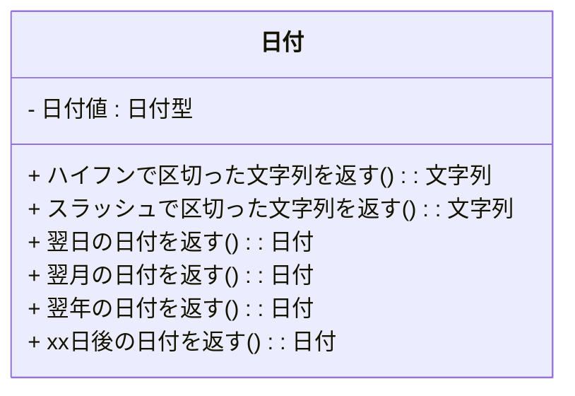
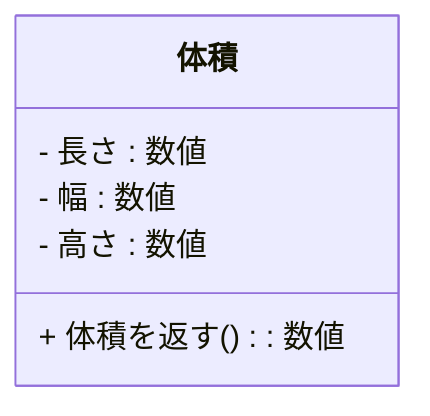

## 様々なクラスで再利用可能なのが小粒クラス

粒度が非常に小さいクラスのことを小粒(こつぶ)クラスと私は呼んでいます。次のようなものです。

-   数量
-   金額
-   日付
-   氏名
-   宛先
-   クレジットカード番号
-   電話番号

などなど。  
これらは、他のクラスの属性として使われることを前提としています。そのため、極めて汎用的に設計しておく必要があります。その代わり、一度作ってしまえばシステムや時代をまたがって再利用することが可能です。

### 数値系クラス

業務システムで一番使うのが数値系のクラス群です。まずは以下のクラス図を見てください。  

たかだか数量や金額にこんなにたくさんのクラスが出てくるのか、と驚く人もいるでしょう。図に出てくるクラスを列記します。

1.  数値
2.  数量
3.  金額
4.  通貨※
5.  円貨金額
6.  消費税率一覧
7.  消費税率
8.  外貨金額
9.  レート一覧
10.  レート

※通貨は数値系クラスではありません。  
順に見ていきましょう。

#### 【数値】

数値系全てのクラスの最上位に位置するクラスです。数値を取るクラスを汎化して抽出されたクラスです。  
内部では、各言語が持っている十進数クラスを利用することになります(Javaではjava.math.BigDecimal)。その上で、

-   業務上必要な演算処理(例えば四則演算)
-   カンマ区切りの文字列を編集して返す

などの処理を実装します。こうすることで、**文字列編集用の関数を別途用意する必要がなくなり**、さらに、画面・帳票・バッチとありとあらゆるプログラムで共通利用することが可能となります。

#### 【数量】

数量クラスは、

1.  数値
2.  単位

の2つの属性から出来ています。例えば、

-   3個
-   10kg
-   43坪

などの情報を持つことになります。  
システムの性格にもよりますが、**デフォルトの単位を「個」**にしておくと便利でしょう。  
そして、

-   単位付きの文字列を返す

という処理を持たせます。上記で書いた例のような文字列そのものが返ってくるのでとても便利です。  
場合によっては、「単位」もクラスとして定義しておく必要があります。

#### 【金額】

**様々な通貨の金額を汎化した**クラスです。このクラスは通貨を持ちます。アプリケーションはこのクラスのオブジェクト(インスタンス)を直接扱うのではなく、円貨金額と外貨金額のオブジェクトを使います。  
このクラスは、

-   通貨記号付きカンマで返す

というメソッドを持ちます。例えば、**$123,456,789**という文字列を返します。  
上記クラス図は日本の業務システムで利用する前提で記述してあります。FX取引などのサイト開発では外貨→円貨のみの金額変換ではなく全ての通貨の相互変換が必要になるため、円貨と外貨を区別しないモデルが必要なことに注意してください。

#### 【通貨】

通貨は、金額が**どこの国(または地域)の通貨であるか**を示すために必要です。このクラスはレート一覧を持ち、指定された日付(あるいは年月)のレートを返す処理を持ちます。  
通貨は数値系のクラスではありません。

#### 【円貨金額】

日本の通貨である**円の金額**を持ちます。そして日本特有の処理である「消費税額を返す」処理を持たせます。こうすることで、消費税計算の関数を別途作る必要がなくなります。消費税率を特定するために消費税一覧クラスを持ちます。  
消費税額を計算するためには次の判断が必要になります。

1.  内税
2.  外税
3.  税自身

3番目の「税自身」というのは、消費税額自身を持つインスタンスであることを示します。

-   内/外税区分

という属性でこれらの値を持ちます。  
日本の業務を前提にしたシステムの場合、円貨金額の通貨を明示的に保存しておくことはしません。その場合は金額クラスが通貨クラスを持つのではなく、外貨金額が通貨を持つように設計するといいでしょう。  

#### 【消費税率一覧】

複数の消費税を持つ「一山クラス」です。消費税は日付によって税率が異なるため複数あり得るのでこのクラスが必要です。  
日付を基にして消費税率を判断し、それを返すメソッドを持ちます。

#### 【消費税率】

消費税率の数値を持ちます。2011年時点の消費税率は5%ですが、この時に

-   5
-   0.05

のいずれで持つのかは設計者の判断になります。その持ち方に合わせて、円貨金額クラスの消費税額を返すメソッドを実装します。

#### 【外貨金額】

円貨以外の金額を保持するクラスです。保持している金額値を円貨に換算するための

-   円貨金額に変換する

メソッドを持ちます。このメソッドの中では、通貨クラスの

-   レートを返す

メソッドを利用してレートを取得し、計算します。レートを決めるためにはその金額が発生した日付(場合によっては年月)が必要になります。

#### 【レート一覧】

**レートを複数持つ一山クラス**です。**レートは日付によって変わる**ためこの一覧クラスが必要になります。  
日付によってレートを特定するための

-   レートを返す

メソッドを実装します。 **自国通貨金額(日本では円貨金額)のレート値は常に「1」**であるため特殊処理が必要になります。通貨クラスが自国通貨フラグを持っているのはこのためです。

#### 【レート】

為替のレート値を保持するクラスです。このクラスは、

-   レート値
-   日付

を持ちます。場合によって日付は年月になることもあります。

### 日付クラス

日付クラスは何かが実行された年月日を持っているクラスです。年月日は、暦としてあらかじめ定義されているある**特定の日**を表現するので

-   物クラス

として扱います。業務システムにてよく利用される「営業日マスタ」を想像してもらえば解りやすいと思います。

-   2011年8月17日の売上金額
-   2011年8月17日の契約件数

を考えた場合、売上金額と契約件数という違いはあるものの、両方とも同じ**2011年8月17日**という日のオブジェクトを指しています。

日付クラスはとても汎用的に設計する必要があります。例えば、

-   区切り文字で日付を編集した文字列を返すメソッド

を実装するにしても、

-   スラッシュ(/)で区切るメソッド
-   ハイフン(-)で区切るメソッド

などがいくつか必要になります。また、

-   翌日の日付を返す
-   翌月の日付を返す
-   翌年の日付を返す

なども持っていると使う側が便利です。  
特に会計システムなどでサイト計算が必要な場合は、

-   xx日後の日付を返す

というメソッドも持ちます。  

Javaで実装する場合、java.util.Calendarクラスを日付値として内部で利用します。  
日本でのみ使われる前提のシステムの場合はロケールを意識しなくて済みますが、グローバルシステムの場合はシステムが稼働しているロケールも意識して日付編集を行う必要が出て来ます。

### その他の例

かつて関わった物流プロジェクトにて**体積クラス**というのを設計しました。

-   長さ(Length)
-   幅 (Width)
-   高さ(Height)

という3つの属性を持ち、3者を乗算して

-   体積

を返すというものです。  
複数の部品を梱包した荷姿が不定型で、出荷する荷姿ごとに体積を管理する必要があったためです。  
この体積クラスは**結果クラス**に分類されます。  

### まとめ

-   他のクラスの属性として利用されるのが小粒クラス
-   代表的なクラスは数量・金額・日付

### コラム

小粒クラスを見逃していると綺麗な設計が出来ず、関数に頼った実装になってしまいます。

-   氏名
-   住所

など、文字列で表現される小粒クラスは特に見逃されがちです。  
O/Rマッパによっては、

-   RDBテーブル上で複数の属性となっているものを一つのクラスにマッピングできない
-   標準ではない自作のクラスをマッピングできない

などの制限があり、小粒クラスが使いづらい場合もあります。  
そういう場合であっても、マッピングを自前でコーディングすることによって小粒クラスを使うようにして下さい。保守性が格段に上がることを経験できるでしょう。

次: [リンゴ一個とリンゴ一山は異なるクラス](6_%20リンゴ一個とリンゴ一山は異なるクラス.md)
