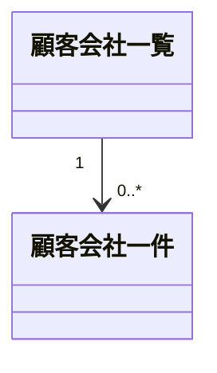
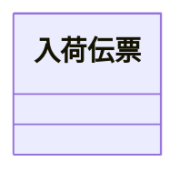
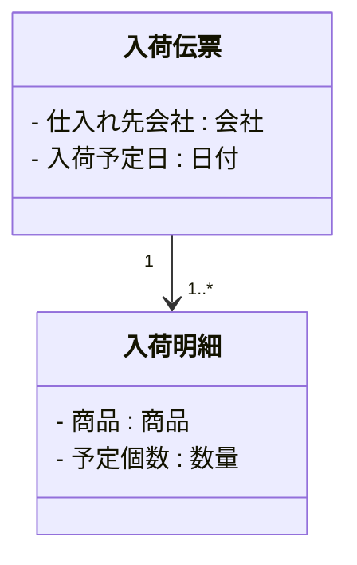
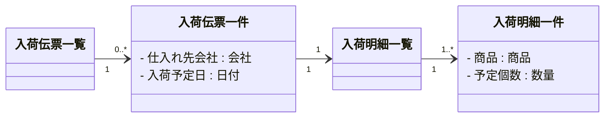
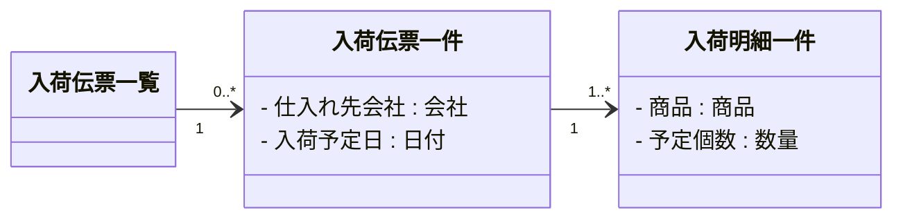
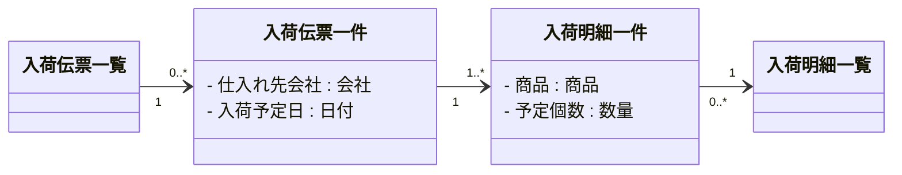
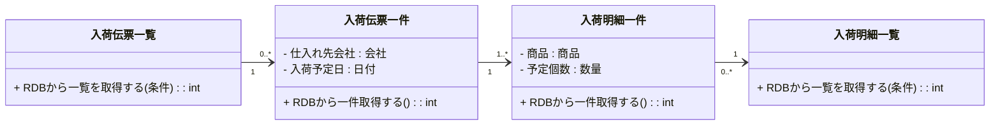
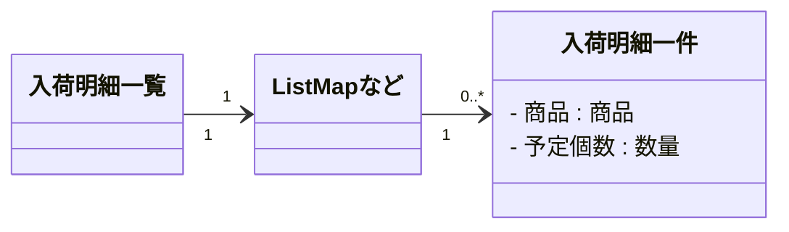
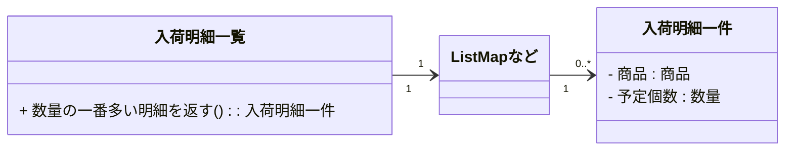

### 単位が異なれば同じ物でも異なるクラスになる

「**一個売りしているリンゴ**」をシステムで扱う場合、どのような属性が必要になるかを考えてみます。

1.  品種
2.  重さ
3.  売り値
4.  入荷日
    
などが考えられます。それでは、「**一山(ひとやま)売りしているリンゴ**」はどうでしょうか?

1.  品種 (同じ山には同じ品種を乗せる前提)
2.  重さ (一山あたりの総重量)
3.  売り値 (一山あたりの総額)
4.  個数
    
上記を較べてみると、同じリンゴでも違いのある事が解ります。処理を考えてみるとさらに明らかになります。  
「一山売りしているリンゴ」では、

-   一個あたりの売り値(平均の売り値)を返す

というメソッドがすぐに思い浮かびます。  
これらから解るように、「リンゴ」というクラスが設計段階、特に分析クラス図で出てきても、

-   それが一個なのか一山なのかを確定させないと正しいクラスとして設計できない

のです。裏を返すと、同じリンゴであっても、

-   それを扱う単位が異なれば異なるクラスになる

ことを理解して設計する必要があるということです。

### 要件の中に出てくる単位を見逃さない

前項で解るように、**単位は非常に重要**です。ここで言う単位は物理学で言うものではなく、**業務を遂行する人たちがあるものをひとかたまりとして扱う大きさ**のことです。

-   一伝票
-   一明細
-   一会社
-   一組織
-   一箱
-   一取引
-   一件
-   一覧

など色々ありますが、人間が何かをひとかたまりとして扱い、そのかたまりの種類が異なる場合には必ず単位が異なります。もちろん、非常に汎用的な「一個」という単位はあちこちに出てきますが、その場合は「何々一個」というように聞き分けて設計していけば問題ありません。

### 実際のシステムでは一件クラスと一覧クラス

このページの見出しにある「リンゴ一個とリンゴ一山」を実際のシステムではどう考えればいいのでしょう? 答えは簡単で、

-   『一件』と『一覧』は異なるクラスとして設計・実装する

です。『一件』がリンゴ一個に相当し、『一覧』がリンゴ一山に相当します。  
例えば業務要件を聞いている中で「顧客会社クラス」が出てきた場合は、

1.  「顧客会社一件クラス」
2.  「顧客会社一覧クラス」

の二つの可能性があります。 顧客会社を一件のみ、つまり一会社として扱う時のクラスが「顧客会社一件クラス」です。顧客会社を複数件で、つまり**一覧として扱う場合は「顧客会社一覧クラス」を作ります**。そして、

-   一覧クラスは一件クラスを内部で複数持つ

ように設計します。ほとんどのシステムにおいてその両方が必要です。

別の例を出しましょう。入荷予定の結果クラスである「入荷伝票」を考えてみます。

入荷業務で良く出てくる、  

-   入荷伝票
-   入荷明細

は、「一伝票」と「一明細」というように**単位が異なるので別クラスとして定義**します。伝票は、ある仕入れ先からのある日の入荷物全体を表現しています。伝票ヘッダとも言われます。明細は商品単位の情報を持っており、一伝票が複数の明細を持つ形です。

さらに、  

1.  入荷伝票一覧クラス
2.  入荷伝票一件クラス
3.  入荷明細一覧クラス
4.  入荷明細一件クラス

というように、それぞれ**一覧**と**一件**というように4つに分けて考えます。

これらのクラスの考え方は次の通りです。「一伝票」「一明細」というように異なる単位で呼ばれる物を見つけたら、それらをさらに「一覧」「一件」というふうに分けて考えます。

| モノ | 一覧 | 一件 |
| --- | --- | --- |
| 入荷伝票(ヘッダ) | ○ | ○ |
| 入荷明細 | ○ | ○ |

  
しかし上の図を見て、次のような設計でいいのではないかと気付いた人がいるかもしれません。**伝票一件が明細一覧も兼ねる形**です。  

実は、

-   入荷伝票クラスは入荷明細に対する一覧クラスを兼ねている

のです。また、

-   伝票に依存しない明細一覧オブジェクトを形成したい

場合に上記ではうまくいきません。例えば、

-   全ての伝票の中から商品Aだけの明細一覧を表示する

というような要件に対応できないのです。入荷明細一覧クラスから参照できる入荷伝票が1つしかないことになり、

-   入荷明細に商品Aを持つ複数の入荷伝票

という関係を表現できません。 このため、入荷伝票が入荷明細一覧クラスを兼ねる形で設計しておくようにします。  
それとは別に、入荷伝票とは独立して入荷明細を一覧化するためのクラスも設計します。次のような形です。  

上記図のカージナリティに注意して下さい。

-   入荷伝票一件クラスと入荷明細一件クラスは「1:1以上」
-   入荷明細一覧クラスと入荷明細一件クラスは「1:0以上」

となります。入荷明細が1件も存在しない入荷伝票は許されません。一方で、「商品Aを持つ入荷明細」を検索した場合の結果が0件となることはあり得ます。

### RDBならば一レコードと一テーブルが別クラス

永続化装置としてRDBを使うことが実際の開発では日常的です。この時には、RDBテーブル一つに対して

-   一レコードクラス
-   一テーブルクラス (複数レコードを扱う時のクラス)

を必ず対(つい)で設計・実装するようにします。 **一レコードクラスは前項で書いた一件クラスと同じ事**です。物や結果の一件分がRDBテーブルの一レコードとして保存されます。  
一テーブルクラスというのは少し解りにくいのですが、複数のレコードを扱う時に使います。

-   複数のレコードというのは最大でそのテーブルの全件を持つ

ことになり、言葉を換えると

-   一テーブル分

となります。これも前項で出てきた**一覧クラス**と同等です。  
関係をまとめると、

-   一件クラス ⊇ 一レコードクラス
-   一覧クラス ⊇ 一テーブルクラス

となります。それぞれ何が違うかというと、一件クラスまたは一覧クラスのうちRDBに永続化する必要のあるものが一レコードまたは一テーブルという**別の呼び方をされることがある**というだけです。永続化される必要の無いものは別名では呼ばれません。  
その上で、

-   RDBから一件を取得する処理
-   RDBから一覧を取得する処理

をそれぞれのクラスの中に実装します。次のような形です。 

 
この際、入荷伝票一件クラスのRDBから一件を取得する処理の中で、

-   ひも付く複数件の入荷明細を取得する処理

も実装します。

### 「複数件」が出てきたら一山クラスを作る

RDBテーブルに限らず、**同じものを複数件扱う要件が出てきたならば「一山クラス(一覧クラス)」を必ず作ります**。これをせずに実装者任せにして何でもかんでもList(配列)に入れて実装してしまうと、いざ仕様変更が発生した時にあちこちを修正することになっていまいます。  
Javaで実装する場合、ListやMapなどのコレクション(Collection)を一山クラスの内部で使います。

明細の一覧を画面に表示する場合にある規則で並べたい、例えば商品順に並べたいような場合、一覧クラスの中でTreeMapクラスを使います(ただし入荷商品に重複がない前提)。そうすることで、ソート処理を別途用意する必要がなくなります。明細一覧というデータ構造とソート処理を分離することなく実装できるのです。  
ソートに限らず、業務的な処理も一覧の中に実装します。例えば、「数量の一番多い明細を返す」という処理です。

### まとめ

-   単位が換われば異なるクラスにする
-   複数件を扱う場合は一覧クラスを必ず作る

### コラム

つい最近(2011年7月)ですが、「Grailsの開発においてリンゴ一山クラスを見逃していた結果、仕様変更の反映が数十ヶ所に及んでしまい工数をロスしました。」と、うちの若手が後悔していました。  
**リンゴ一山クラスを作成せずに**何でもかんでもList(配列)に入れて実装してしまうと、似たような処理があちこちに作られる危険が高くなります。データと処理が分離されてしまうからです。  
皆さんの開発現場において設計者がリンゴ一山クラスを見逃しているようならば、このページの内容を参考にして指摘してあげて下さい。  
