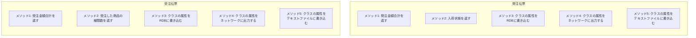
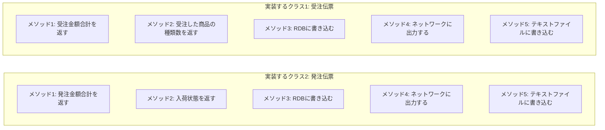
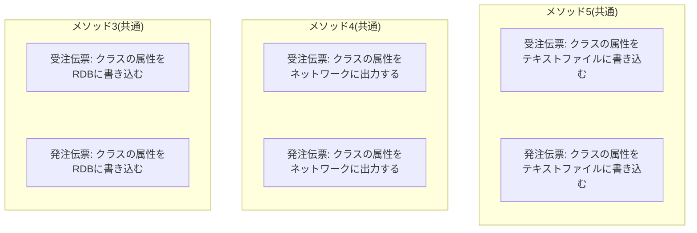
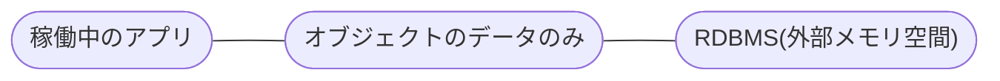
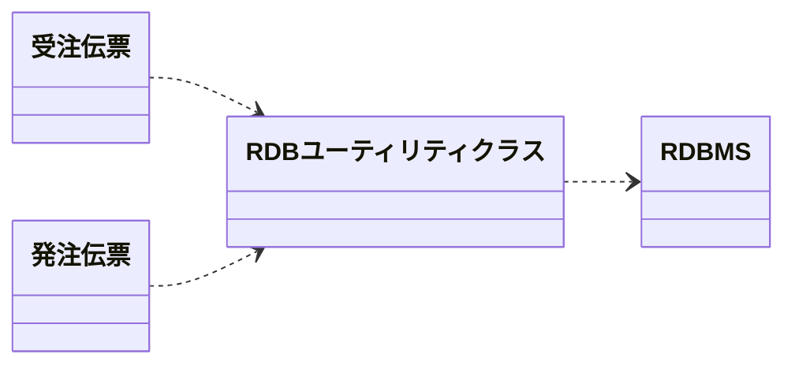
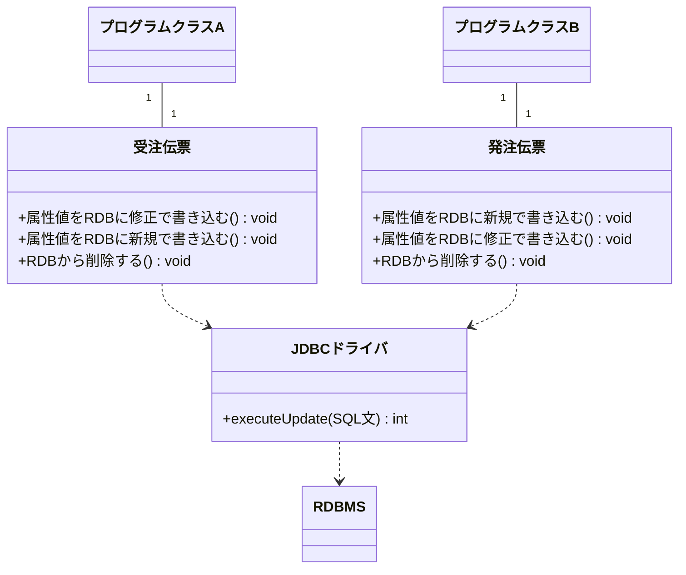
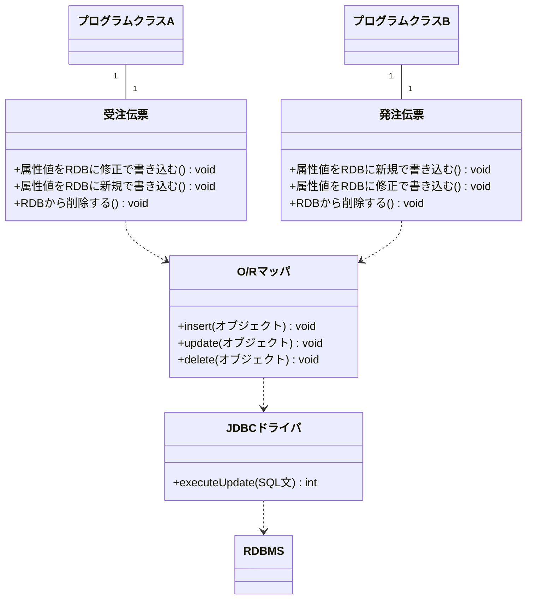
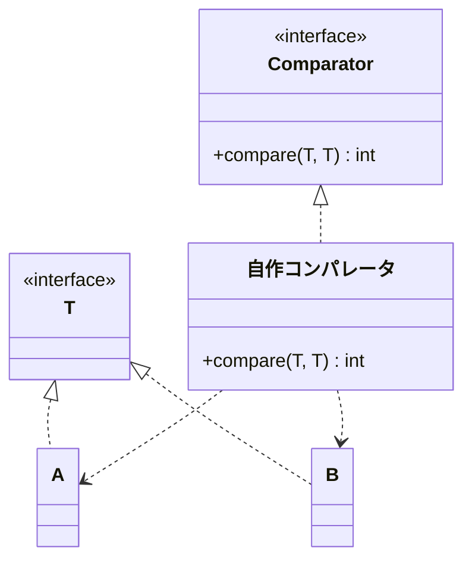
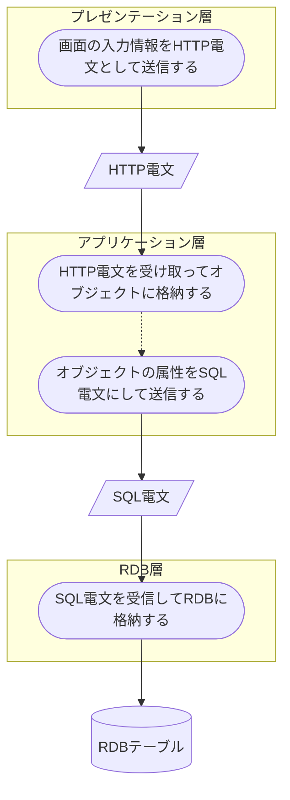

### 関数を作ってはいけない

**関数**というのは、Cなどの手続き型言語で言う関数のことです。  
関数を正確に表現すると、

-   クラス変数にもインスタンス変数にも一切アクセスしないメソッド

です。次の例が関数です。

```java
/* 姓と名を基に氏名を返す */
public String getFUllName(String surName, String givenName) {
    return surName + "  " + givenName;
}

/* 消費税額を返す */
public BigDecimal getSalesTaxf(BigDecimal amount) {
    BigDecimal tax = new BigDecimal(5);
    return tax.multiply(amount).divide(100, RoundingMode.HALF_UP);
}
```

クラス変数にもインスタンス変数にも一切アクセスしないということは、

-   そのオブジェクトが持つ**データ構造に依存しない**

ことになります。

-   クラスとはデータ構造

という原則にこれは明らかに反します。そして、

-   関数を作ってしまうとデータ構造と処理が分離される

ことになり、保守性が下がってしまいます。

### ユーティリティクラスを作ってはいけない

関数を作ってはいけないのだから、

-   ユーティリティクラスと世間で言われるクラスも当然作ってはいけない

ことになります。ユーティリティクラスというのは関数の単なる集まりであり、データ構造を持たないクラスだからです。  
ユーティリティクラスと関数の弊害については「[privateメソッド禁止](8_%20Privateメソッド禁止.md)」の中で詳細に説明しているので参照して下さい。

### 例外的に関数を許す場合

次の3つのケースでは例外的に関数を許します。

1.  メイン関数
2.  異なるクラスを同一の処理で扱いたい場合
3.  別メモリ空間で稼働するシステムのオブジェクトが持つデータを受け取る場合

例外的にとは書きましたが、これらの事例は多く存在します。

### メイン関数

OSがアプリケーションを起動する場合、メイン関数が起点となります。OSは、起動パラメータをデータとしてメイン関数に渡します。この時、

-   起動パラメータ(データ)
-   メイン関数(処理)

の二者は、プログラムの外部から与えられるもの(パラメータ)とプログラム処理として分離されざるを得ません。そのため例外となります。  
メイン関数の中には必要最低限の処理のみを記述するようにし、

-   業務用クラスのオブジェクトに処理を早く委譲すべき

です。

### 異なるクラスを同一の処理で扱いたい場合

二つ目の例外がこれですが、抽象的な言葉過ぎて解りにくいと思うので具体例を使って説明します。

#### 1.何かのメディア(媒体)に読み書きしたい場合



上記のように「受注伝票」と「発注伝票」の2つのクラスがあるとします。それぞれのクラスにはメソッドがあります(実際の開発では上記以外のメソッドも必要になります)。  
この時、実装すべきクラスは次のように2つです。



ところが良く考えると、

-   クラスの属性をRDBに書き込む
-   クラスの属性をネットワークに出力する
-   クラスの属性をテキストファイルに書き込む

というメソッドは他のクラスにも共通して必要です。システム規模によりますが、最低でも数十、大きい場合は数百のクラスに実装する必要が出てきます。



この3つのメソッドに共通しているのは、データを書き込む先が全て、これらのオブジェクトが稼働しているのとは別のメモリ空間で動いているシステムです。別のメディアと言ってもいいでしょう。

| メディア | メモリ空間 |
| --- | --- |
| RDB | RDBMS |
| ネットワーク | OS |
| テキストファイル | OS |

このように、別のメモリ空間で稼働しているシステムに対してはオブジェクトの状態で渡すことが出来ません。そのため一旦データ(属性)のみの状態にして相手側のシステムに渡す必要が出てきます。次の図のように、稼働中のアプリケーションと、外部のメモリ空間で動いているシステムとの間で**データのみを投げ合う**形です。



この時、

-   オブジェクトが持っているデータ構造
-   相手側のシステムとの間で受け渡す処理

の2つが分離されます。つまり、

-   相手側のシステムとの間で受け渡す処理を関数として実装する

必要が出てきます。相手に渡せるのはデータのみであり、

-   そのデータをやりとりする処理を独立させた方が効率が良い場合が多い

からです。  
これをクラス図に描くと次のようになります。RDBユーティリティクラスが、受注伝票や発注伝票の属性値のみ(データ)をRDBMSとの間で受け渡しします。アプリケーションが稼働しているメモリ空間の外にRDBMSはあります。


(受注伝票・発注伝票・RDBユーティリティクラスはアプリケーション境界内、RDBMSは境界外)

Javaの場合、RDB関数の最下層には**「JDBCドライバ」(Java Database Connectivity Driver)**が配置されます。 しかし、受注伝票や発注伝票の中に「RDBに書き込む」「RDBから読み込む」ようなメソッドを持ち、その中からRDB関数(群)を利用することによって、受注伝票や発注伝票を扱うプログラムクラス側からはデータ構造と処理が一体化されている正しいクラスとして扱えます。次のような形です。



**O/Rマッパ(Object Relation Mapper)**がJDBCドライバの上位に配置されることが実際の開発では多いのですが、そのO/RマッパがRDBストレージの代理として表現されることによって、オブジェクト指向により近い実装になります。O/RマッパがJDBCドライバを隠蔽することにより、受注伝票や発注伝票などからは**RDBMSオブジェクトに処理を委譲している**形を取ることが出来ます。


(O/RマッパとJDBCドライバは内側の枠で囲まれ、RDBMSのみ外側の境界の外にある)

  

#### 2.異なるクラスをComparatorによって比較したい場合

JavaのAPIで提供されているjava.util.Comparatorインタフェースのcompare()メソッドは関数です。

```java
public int compare(T o1, T o2)
```

o1およびo2オブジェクトのクラスそのものが**java.lang.Comparableインタフェース**を実装していれば、Comparatorインタフェースによる比較は必要ありません。しかし次のような時があります。

-   Comparableインタフェースを実装していないオブジェクトを比較したい
-   比較したいオブジェクトが異なるクラスである

上記のような場合は自作のComparatorを作る必要が出て来ます。次のようなイメージです。  


この項で説明した関数は、オブジェクト指向の前身である「構造化言語」の特徴を引き継いだものです。このページのタイトルは「関数禁止」となっていますが、それは安易に関数を量産してしまうことを戒めているのであって、上記のように理解した上で使うことは問題ありません。

### 別メモリ空間で稼働するシステムのオブジェクトが持つデータを受け取る場合

前項で説明したように、外部のメモリ空間で稼働しているシステムとのやりとりが発生する境界では、オブジェクトではなくデータのみをやりとりする必要があります。これは言い方を換えると、

1.  RDB層
2.  アプリケーション層

などのような

-   層(Layer)があればその境界線で関数が必要になる

ということです。次の図を見て下さい。



上の図は、一般的な3層構造アプリケーションの動きのうち、画面の情報をRDBに格納するまでの流れを表しています。層と層の間はオブジェクトをそのまま渡せないため、

-   電文という形でデータ構造を渡す

ようになっています。電文を受け取るプロセスは、

-   各層での処理の起点の役割、つまりメイン関数と同等の機能

を負います。そのため関数にならざるを得ないのです。例外的に関数を許す場合の1番目で書いたのとほとんど同じ理由です。  
例えばアプリケーション層の起点ではHTTP電文を受け取ってオブジェクトへと変換します。この動きをメイン関数と比較すれば、**起動パラメータがHTTP電文と替わるだけ**であることが解ります。Javaサーブレットを使ったWebアプリケーションの場合、サーブレットそのものがこの関数になっています。 次の例は**javax.servlet.http.HttpServlet**の**doPostメソッド**ですが、サーブレットアプリケーションにおいてリクエストを電文として受け取る処理の起点になります。レスポンスを戻り値としてはいませんが、引数として受け取ったHttpServletResponseオブジェクトに対して返りの電文(データ)を出力する形の関数を実装することになります。

```java
protected void doPost(HttpServletRequest req, HttpServletResponse resp) {

}
```

結果として、

-   層分けを出来るだけ行わない方が本来のオブジェクト指向に近づける

のです。「データと処理の分離」の発生頻度が減るからです。

### まとめ

-   クラス変数にもインスタンス変数にもアクセスしない処理(つまり関数)を作ってはいけない
-   ただし以下は例外
    -   メイン関数
    -   異なる複数のクラスを同列視したい場合
    -   「層」の間

### コラム

このページを読んで、「ユーティリティクラス無しで実際の開発が出来るわけがない」と感じた人は多いでしょう。裏返すとそれは、オブジェクト指向的でない実装が現場でいかに蔓延しているかを表していることになります。  
ユーティリティクラス無しで実装するためには以下の二種類のクラスを見逃さずに設計することが必須です。

-   [小粒クラス](5_%20小粒クラス.md)
-   [リンゴ一山(ひとやま)クラス](6_%20リンゴ一個とリンゴ一山は異なるクラス.md)

小粒クラスは、システムをまたがった再利用を促進します。一度作れば色々な業務で利用でき、保守性を向上させます。  
リンゴ一山クラスは、同じ処理があちこちで実装される危険性を排除します。

これらのクラスをしっかりと設計すれば、「関数とユーティリティクラスっていらないんだ」と気付くことでしょう。
