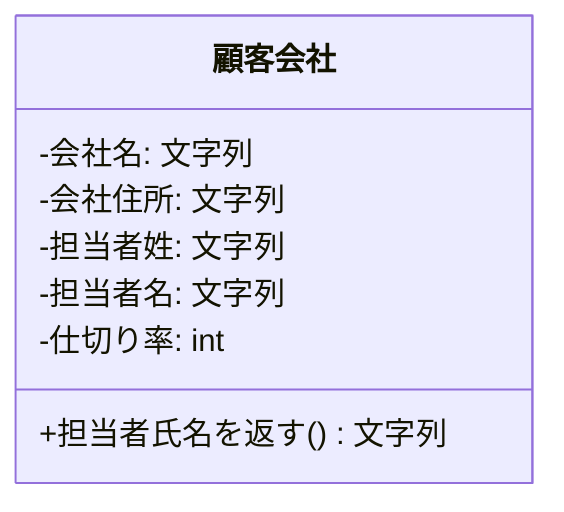
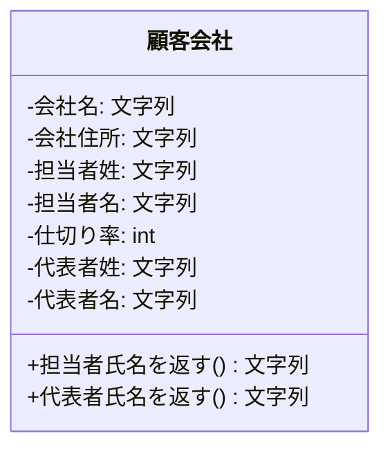
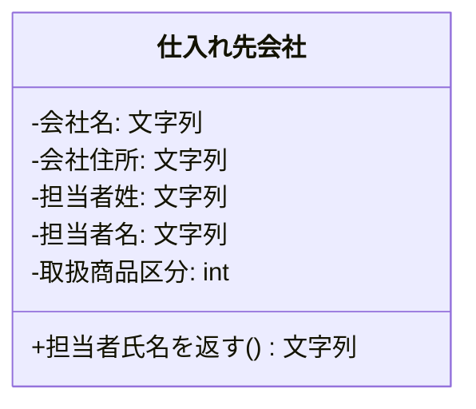
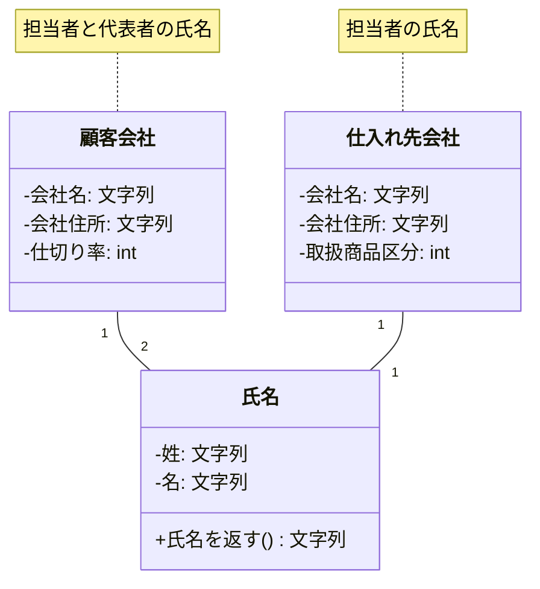
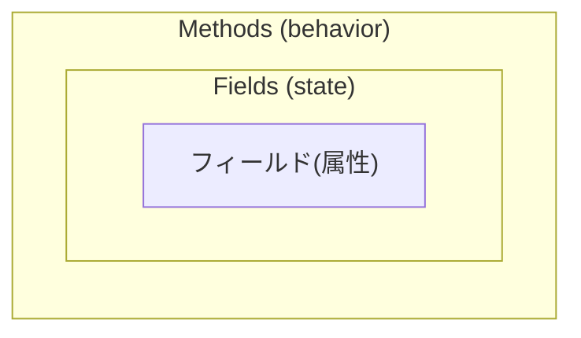
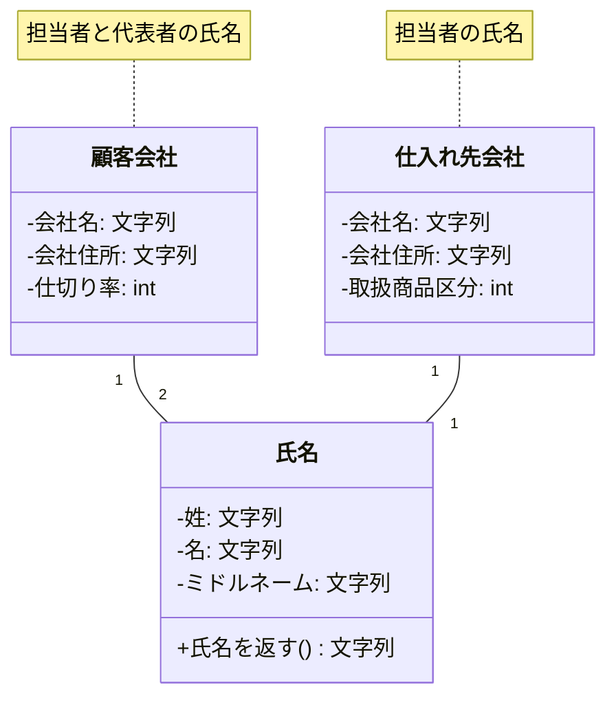

### privateメソッドを作りたくなった時は存在するべきクラスを見逃している

このページの見出しを見て「えっ?!」と思う人は多いでしょう。でも、私がマネージメントする開発では「privateメソッド禁止」は当たり前なんです。  
例を使った下の説明で詳しい内容は理解して欲しいのですが、要点だけを言うと、

-   privateメソッドに渡すパラメータをひとかたまり(データ構造)とするクラスを見逃している

ということです。

### 顧客会社クラスで考えてみる

商取引を扱うシステムで良く出てくる「顧客会社」クラスを使って考えてみます。  


-   担当者姓
-   担当者名

という属性がこのクラスの中にはあります。そしてこの二つの値を使った

-   担当者氏名を返すメソッド

を作ってみます。姓と名の間にスペースを挟んで返す仕様だとすると、コードは次のようになるでしょう。

```java
public String getTantoushaFullName() {    return this.tantoushaSei + " " + this.tantoushaMei;}
```

次に、このクラスが仕様変更となり、

-   代表者姓
-   代表者名

という属性が追加されたとします。  


-   代表者氏名を返すメソッド

もこの時必要になったとすると、以下のようなコードを追加することでしょう。

```java
public String getDaihyoushaFullName() {    return this.daihyoushaSei + " " + this.daihyoushaMei;}
```

そして次に、

-   いずれの氏名を返す時も、姓と名の間のスペースを2つに替えて欲しい

という要望が挙がったとします。よく見てみると上記二つのメソッドは非常に良く似ています。「スペースを挟んで姓と名を連結する」という仕様だからです。こういう時、privateメソッドを作っておくと変更が1ヶ所で済んだはずです。次のようなコードです。

```java
private String getFullName(String sei, String mei) {    return sei + "  " + mei;}public String getTantoushaFullName() {    return getFullName(this.tantoushaSei, this.tantoushaMei);}public String getDaihyoushaFullName() {    return getFullName(this.daihyoushaSei, this.daihyoushaMei);}
```

こうしておけば、間に挟むスペースが3つに替わろうが変更箇所は1ヶ所で済みます。  
が、果たして本当にそうでしょうか?  
例えば

-   仕入れ先会社クラス



が別にあったとして、その属性にも「担当者姓」「担当者名」があったとしたらどうでしょう? そしてそのクラスにも「担当者氏名を返す」というメソッドが必要で、「姓と名の間にスペースを2つ挟む」という仕様だったら? そのクラスにも同じようなprivateメソッドが必要になってしまい、仕様変更への対応が1ヶ所というわけにいかなくなってしまいます。

### データ構造を見逃すな!

上記の例で解るように、

-   privateメソッドを作りたくなった時はクラスを見逃している

のです。  
privateメソッドはクラス内の共通関数に当たるのですが、共通関数を作ろうとすれば、その関数に渡す**パラメータをそもそもまず共通化する必要があります**。

-   そのパラメータをひとかたまり(データ構造)とするクラスを作るべき

なのです。  
この場合は、属性として

1.  姓
2.  名

を持つ**氏名クラス**を作るべきです。そしてそのクラスに**委譲**するのです。  


### パラメータを持たないprivateメソッドはもっとだめ

「privateメソッド禁止」の話をする際によくある反論が、「パラメータを持たないprivateメソッドだってあるじゃないか!」というものです。  
パラメータの無い、つまり**共通関数ですらないprivateメソッド**がなぜ必要なのでしょうか? 彼らの答えは「可読性をあげるため長いコードを分割するんだ。」なのですが、これは全くの誤りであると私は考えます。  
なぜならコードが長くなるのは、上記のような小物クラスを見逃しまくっていて、結果的に手続き的な記述になっているからだと断言できるからです。クラスという単位で分かれているべきものが一つになってしまっていれば、その中の記述が長くなってしまうのは当然です。  
そもそも一連の処理ならばprivateメソッドなどに分割せず、処理の流れの通りに1ヶ所に書いてある方が、第三者が見た時の可読性は高いはずです。下の例を比べてみて下さい。

#### privateメソッドに分割した例

```java
public String getSomething() {    doSomething1();    doSomething2();    doSomething3();}public String getAnotherthing() {    他の処理が書いてある;}private void doSomething1() {    何かの処理1-1が書いてある;    何かの処理1-2が書いてある;}private void doSomething2() {    何かの処理2-1が書いてある;    何かの処理2-2が書いてある;}private void doSomething3() {    何かの処理3-1が書いてある;    何かの処理3-2が書いてある;}
```

#### 一連の処理が1ヶ所に書いてある例

```java
public String getSomething () {    何かの処理1-1が書いてある;    何かの処理1-2が書いてある;何かの処理2-1が書いてある;    何かの処理2-2が書いてある;何かの処理3-1が書いてある;    何かの処理3-2が書いてある;}public String getAnotherthing() {    他の処理が書いてある;}
```

正しいクラスを定義した結果それでもメソッドの記述が長くなる場合、例えば属性が100個ぐらいあって一つの処理が長くなる場合、それはそれで正しいのです。意味も無く分割する必要は無いというのが私の考えです。

### オブジェクト指向の原則を考えるとそもそもprivateメソッドは不要

[クラスとはデータ構造](2_%20クラスとはデータ構造.md)で説明した次の図をもう一度見て下さい。出典: [What Is an Object?](What%20Is%20an%20Object_%20%28The%20Java™%20Tutorials%20_%20Learning%20the%20Java%20Language.md)


フィールド(属性)の周りをメソッドが取り巻いている形が見えますが、これは裏返すと、

-   フィールドを隠蔽するためにメソッドが口を開けている(公開されている)

ということです。つまり公開されないメソッドはこの原則に反するのです。

-   privateによって隠蔽すべきなのはフィールド(属性)であってメソッドではない

という原則がこの図からも解ります。

### ユーティリティクラスだとどうだ?

「『担当者氏名を返す』メソッドはprivateではなくユーティリティクラスでいいじゃないか?」と思った人もいるでしょう。  
次のようなコードです。

```java
public class StringUtility {    public String getFullName(String sei, String mei) {        return sei + "  " + mei;    }}public class KokyakuKaisha {  :  :    public String getTantoushaFullName() {        return StringUtility.getFullName(this.tantoushaSei, this.tantoushaMei);    }public String getDaihyoushaFullName() {        return StringUtility.getFullName(this.daihyoushaSei, this.daihyoushaMei);    }}
```

[関数とユーティリティクラスは禁止](7_%20関数とユーティリティクラスは禁止.md)でも書きましたが、このようなユーティリティクラス(インスタンス変数にもクラス変数にもアクセスしないメソッド群)はそもそもオブジェクト指向の原則である

-   データ構造と関数の一体化

を崩してしまいます。その結果どういう事が起きるかを考えてみます。  
上記のStringUtility#getFullName()メソッドは単なる関数なので、姓名の連結のみに使われる保証はありません。極端な場合は次のような使われ方をするかもしれません。

```java
public class Jimusho {    private String yuubinBangou = ""; // 郵便番号    private String jyuusho = ""; // 住所     :     :    public String getAtesaki() {        return StringUtility.getFullName(this.yuubinBangou, this.jyuusho);    }}
```

StringUtility#getFullName()メソッドの機能は、「1つめのパラメータと2つめのパラメータを2個のスペースを挟んで連結する」というものです。上記のように、「事務所クラスの宛先を返すメソッド」にこの機能がたまたま使えたとすれば使われてしまう可能性を排除できません。  
この時、システムを国際化対応する必要がもしも出てきて、

-   担当者ミドルネーム
-   代表者ミドルネーム

という属性が追加になったとします。そして、

-   氏名を返すメソッドは全て『姓 ミドルネーム 名』とする(間のスペースは1つずつ)

という要件に替わったとします。  
この場合の変更箇所はStringUtility.getFullName()メソッドのみではなく、それを呼び出している全メソッドが対象となります(当然ですが)。その際、「従業員クラスの宛先を返すメソッド」も該当しますが、事務所クラスは「ミドルネーム」を持たないため破綻してしまいます。別の関数を新たに作る必要が出て来るのです。高い保守性とこれでは言えません。

一方で、「氏名クラス」を利用している場合はどうでしょうか。  
氏名クラスを利用する場合、そのデータは「姓」と「名」として使うことでしょう。「郵便番号」と「住所」を無理矢理入れようと思えば入れられますが、上記のユーティリティクラスの使われ方ほどの可能性はありません。  
なぜならば、ユーティリティクラスの目的は「処理」つまり

-   1つめのパラメータと2つめのパラメータを2個のスペースを挟んで連結する

という**機能を提供すること**ですが、氏名クラスの目的は、

-   氏名を構成する属性(データ構造)を保持すること

だからです。誤用の可能性は低いでしょう。  


氏名クラスを利用している場合、**氏名を返す()**メソッドを呼び出している側の修正は必要ありません。このことがシステムの保守性をいかに高くするかを是非理解して下さい。  
ひとかたまりとなるデータ構造をクラスに閉じ込め、そのデータに関する処理も併せてその中に閉じ込めてしまうことで修正箇所を最小限にしようというオブジェクト指向の目的がこの例からも解ります。

### 例外的にprivateメソッドを許す場合

以下の場合のみprivateメソッドが必要になります。

1.  再帰処理を実装する場合
2.  汎用的なデータ構造を持つクラスを継承せずに利用する場合

### 再帰処理

再帰処理は、メソッドの中からそのメソッド自身を再度呼び出すというアルゴリズムです。  
これを利用する際、

-   外部から呼び出されるメソッド(再帰処理の入り口)
-   再帰的に呼び出されるメソッド(メソッド内部で何回も呼び出される)

という使い分けが必要になる場合があります。この時後者のメソッドをprivateで定義します。  
例えば二分探索木を使う場合、走査の起点をルートノードに固定化したいのですが、その処理は外部から呼ばれたpublicなメソッドで行い、再帰的な走査はprivateで行うという使い分けをします。次のようなコードです。

```java
/* 走査 */public void traverse() {    ascendingTraverse(this.rootNode);}/* 昇順走査 */private void ascendingTraverse(Node current) {    if (current.getLeftNode() != null) {        // 再帰呼び出し        ascendingTraverse(current.getLeftNode());    }        currentに対する何かの処理;if (current.getRightNode() != null) {        // 再帰呼び出し        ascendingTraverse(current.getRightNode());    }}
```

### 汎用的なデータ構造を持つクラスを継承せずに利用する

これは、JavaのArrayListクラスのように汎用的なデータ構造を持つクラスを継承せずに委譲の形で利用する時、その汎用的なクラスに対する特定の扱いを共通化したい場合です。

```java
public class Someclass {    private String name = "XX";    private List<Integer> someList = new ArrayList<Integer>();    :    :    public String firstMethod() {        // リストの初期化        clearList();        何かの処理;        :    }public String secondMethod() {        // リストの初期化        clearList();        別の何かの処理;        :    }/** リストの要素をゼロで置き換える **/    private void clearList() {        for (Integer el : someList) {            el = new Integer(0);        }    }
```

この場合のprivateメソッドは、汎用的なデータ構造を持つクラスを継承するならば必要なくなります。上の例ではArrayListクラスです。ですが、汎用的に出来ているクラスの継承においては、そのクラスのデータ構造を熟知していないと思わぬ副作用に出くわすデメリットもあるため、privateメソッド利用とのデメリットをよく検討した上で選ぶようにして下さい。

### まとめ

-   privateメソッドを作っていけない
-   ただし以下は例外
    -   再帰処理
    -   汎用的なデータ構造を持つクラスを継承せずに利用する場合

### コラム

2000年頃の話ですが、私が初めて仕事でJavaを使ったプロジェクトにて、私は帳票用の自動集計フレームワークを設計・実装していました。  
そのプロジェクトの本番稼働後に仕様追加の依頼があってフレームワークのコードを直そうとしたところ、同じ修正を2ヶ所にしなければならない事が判明しました。そのフレームワークの実装に当たっては、「1ヶ所直せば皆直る」を心掛けていたのにもかかわらずです。  
私は必死になって理由を考えました。そしてこのページで説明した「privateメソッドが癌だった」ことに気付いたのです。その時は新しいクラスを作ってリファクタリングし、仕様変更に無事対応できました。  
オブジェクト指向の出発点は「1ヶ所直せば皆直る」です。難しいことは置いておいても、これを目指して皆さんも設計・実装してみて下さい。そうすれば、オブジェクト指向の核心がきっと見えてきます。

次: [どのメソッドをどのクラスで実装すべきか](10_%20どのメソッドをどのクラスで実装すべきか.md)
