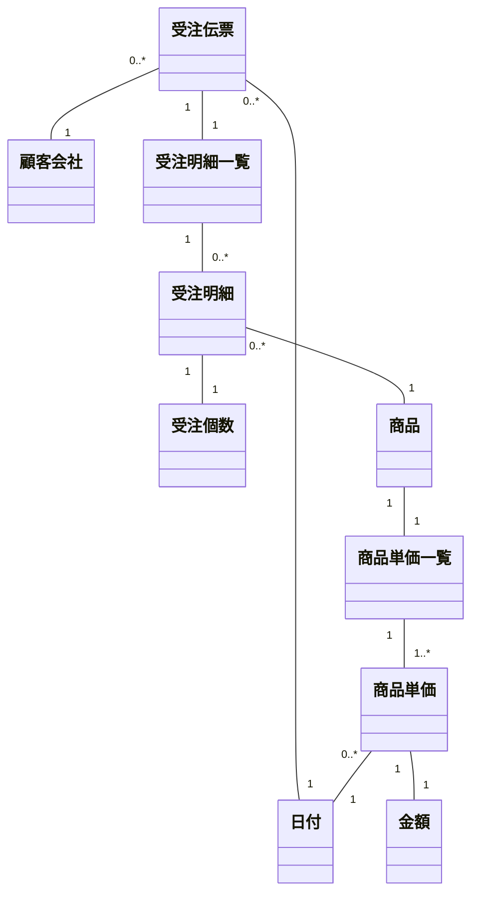
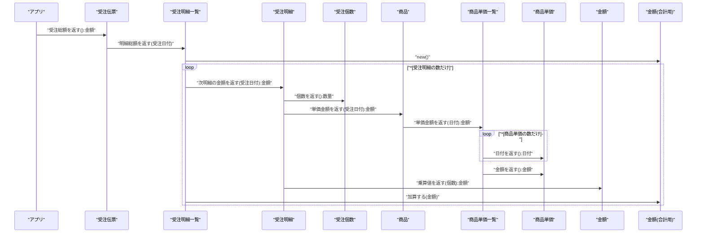
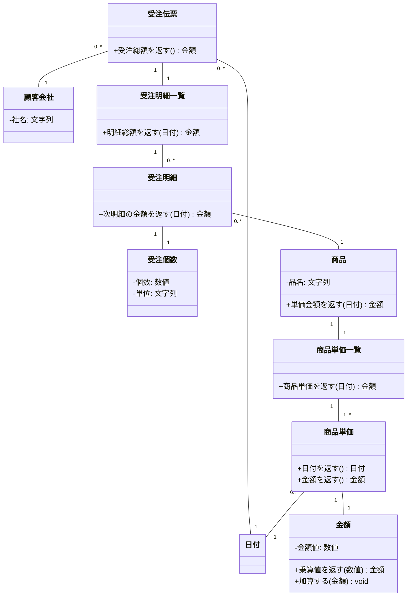
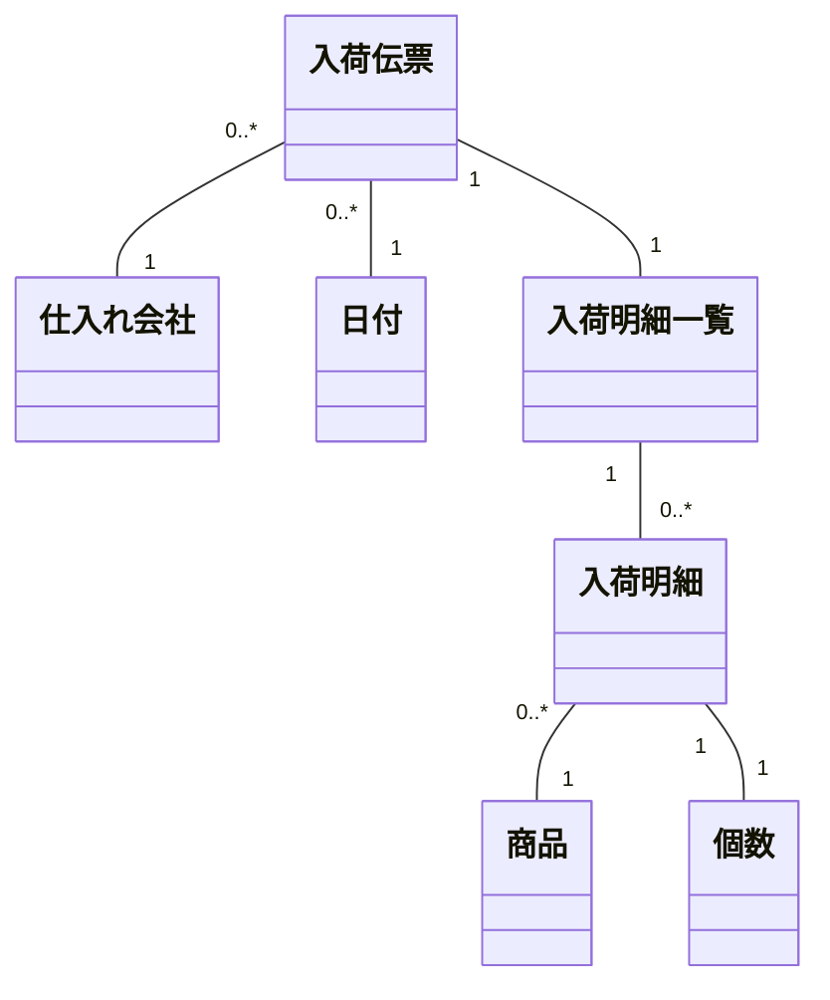
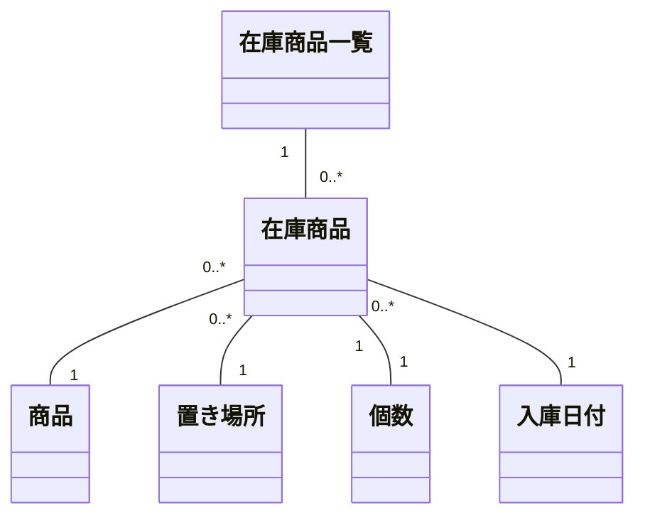
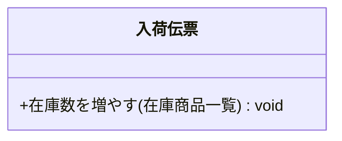
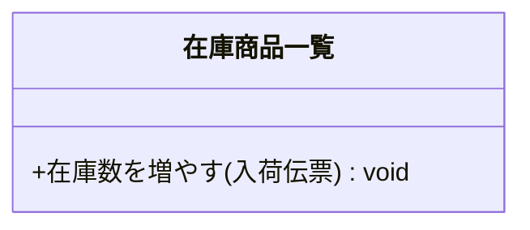
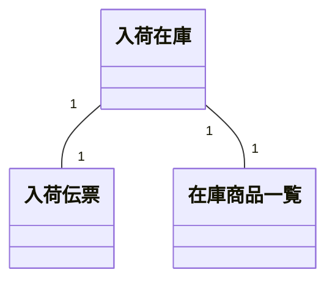
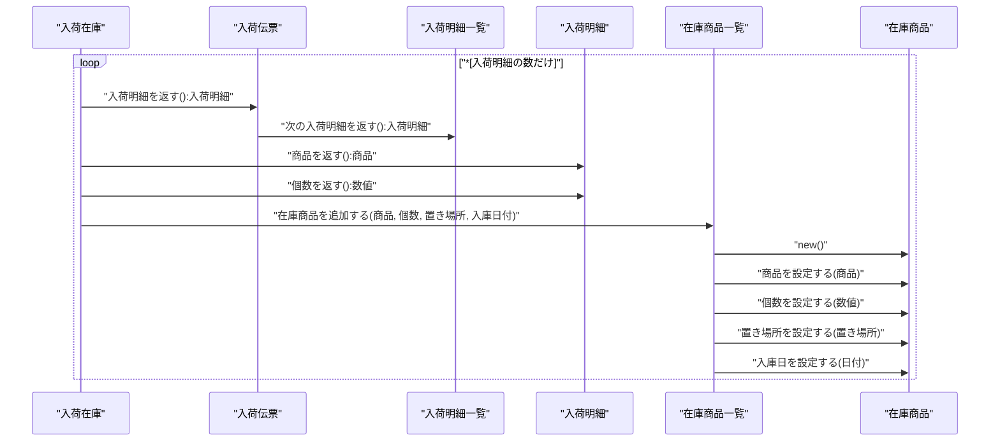

## メソッド実装場所の原則は2つだけ

例えば

1.  Aクラス
2.  Bクラス

という2つのクラスがある場合、

-   両方の属性を参照しながら処理するメソッドはどちらのクラスに実装すべきなのか?

というのがこの章でのテーマです。  
メソッドはパラメータ(引数)を持つので、必要なオブジェクトをパラメータで渡すようにすればどのクラスのメソッドとしても実装できてしまいます(AでもBでも実装できる)。  
しかしそれでは、

1.  第三者が保守する時に解りづらい
2.  仕様変更に弱い

という状態になりがちです。  
保守しづらくなる理由は規則性がないからです。そして仕様変更に弱いのは、クラス間でオブジェクトを不規則に渡していると変更の影響が思わぬクラスに出てしまうからです。

原則は2つしかありません。

1.  ヘッダと明細のような上下関係がクラスにある場合、必要な属性の最上位に当たるクラスのメソッドとする
2.  クラスの関係が対等または並列である場合、第3のクラスを作ってそのメソッドとする(Mediatorパターンの利用)

順に見ていきましょう。

### 必要な属性の最上位に当たるクラスのメソッドとする

この原則は簡単です。受注伝票で考えてみます。  
受注伝票は、商品ごとの受注個数と商品単価を明細として持ちます。この時、

-   ある受注における受注総額を返すメソッド

をどのクラスに実装すべきかを検討してみましょう。分析クラス図は次です。  

受注総額を求めるためには、

1.  明細ごとの受注額を計算する(受注個数 × 商品単価)
2.  全明細の受注額を加算する
3.  受注額を返す

という流れになります。関係するクラスは、

1.  金額
2.  商品単価
3.  商品単価一覧
4.  受注個数
5.  受注明細
6.  受注明細一覧
7.  受注伝票

と7つありますが、受注総額を返すメソッドはどのクラスで実装するべきでしょうか?  
答えは簡単で、

-   関連するクラスのうち最上位のクラス、つまり受注伝票クラス

です。シーケンス図を見て下さい。

※シーケンス説明の**\***印は繰り返す処理を意味します。  
受注伝票を起点にして処理が始まっているのが解ると思います。  
よくある誤りは、受注伝票クラス内にループ処理を実装してしまうことです。シーケンス図にある

-   受注明細の数だけXXする

という部分です。  
ループ処理が必要になるのは受注明細一覧が受注明細を複数持っているからですが、その実体が

-   配列
-   List
-   Map
-   その他

のいずれなのかというのは隠蔽されているべきです。  
その実体を受注伝票にさらしてしまう実装をすると、複数の受注明細を格納するデータ構造が仕様変更によって変わった時、例えばListからMapに変わったような場合に受注伝票も変えなくてはならなくなります。  
これを避けるために、そのデータ構造を持っている受注明細一覧の中でループ処理を実装します。つまり、

-   複数の受注明細というデータ構造の最上位のクラスが受注明細一覧クラス

なのでここで実装することになります。  
さらに、

-   受注明細一覧クラスから受け取った金額を受注伝票ラスが受注総額として返す

ようにします。  
ここで注意すべきなのは、受注伝票クラスの「受注総額を返すメソッド」が必要ないと判断する勘違いです。  
受注伝票を扱うアプリケーションに対して受注明細一覧オブジェクトを返せば一見うまくいくように見えますが、受注明細一覧オブジェクトだけではどの受注に対する明細なのかを特定できません。そのため、受注明細一覧に委譲する形で受注伝票が「受注総額を返すメソッド」を持つべきなのです。  
結果的に設計クラス図は次のようになります。  

### 第3のクラスを作ってそのメソッドとする(Mediatorパターン)

2つのクラスに上下関係にあたるものがない場合、その2つを仲介する3つ目のクラスを作ります。この原則は、Gofのデザインパターンにおける**Mediatorパターン**に応用されています。  
2つのクラスの関係が密接ではない場合に相手のメソッドを直接呼び出す設計をしていると、どちらかのクラスの仕様変更によってもう一方のクラスも修正しなくてはならない事態に陥りがちです。  
商品の入荷と在庫を例に考えてみます。必要になるのは、

-   入荷伝票
-   在庫商品一覧

の2つです。(下図)  

実際の業務では、入荷された商品を倉庫に保存することになります。この時、システム的には入荷伝票を基に在庫数を増やす処理が必要になりますが、この処理(メソッド)をどのクラスで実装するかというのがこの節での命題です。  
考えられるのは、

1.  入荷伝票クラス
2.  在庫商品一覧クラス
3.  第3のクラス

の3通りです。

入荷伝票に実装する場合は、在庫商品一覧クラスをそのメソッドに引数として渡すことになります。  

この時そのメソッド内では、

1.  入荷明細一覧内の入荷明細の数だけ以下を繰り返す
2.  在庫商品インスタンスを生成する
3.  商品、個数、ロケーション、入庫日付を在庫商品に設定する
4.  在庫商品インスタンスを在庫商品一覧インスタンスに追加する

というように実装することになります。入荷伝票クラスは在庫商品一覧クラスの仕様を熟知している必要があります。

逆に在庫商品一覧クラスで実装する場合は、入荷伝票クラスをそのメソッドに引数として渡すことになります。  

この時そのメソッド内では、

1.  入荷伝票から入荷明細一覧を取り出す
2.  入荷明細の数だけ以下を繰り返す
3.  在庫商品インスタンスを生成する
4.  商品、個数、ロケーション、入庫日付を在庫商品に設定する
5.  在庫商品インスタンスを自身(在庫商品一覧)のインスタンスに追加する

というように実装することになります。今度は逆に、在庫商品一覧クラスは入荷伝票クラスの仕様を熟知している必要があります。

入荷の結果である入荷伝票と在庫の結果である在庫商品一覧が密接に結びついても問題ない場合は上記のいずれかでも構わないのですが、相手側クラスの仕様に変更があった場合はその影響を免れません。  
こういう場合は、

-   第3のクラス

を設計しておく方が、片方のクラスの仕様変更を相手クラスに影響させずに済みます。Gofのデザインパターンにおける

-   Mediator(仲介者)パターン

はこの原則を応用したものです。  

この時の処理シーケンスは次のようになります。  

※シーケンス説明の**\***印は繰り返す処理を意味します。  
入荷伝票と在庫商品一覧の仲介者として入荷在庫クラスが働いていることが解ります。この手法を理解する上での注意点は、入荷伝票と在庫商品一覧の両方のデータを持つクラスとして入荷在庫クラスを設計することです。  
単なる仲介者として設計してしまうと「仲介する」処理だけを実装することになります。そうではなく、

-   入荷伝票と在庫商品一覧の両方のデータをひとかたまりとしたクラスである

と強く意識して設計して下さい。

この節の冒頭にも書きましたが、入荷伝票と在庫商品一覧をあえて強く結びつけたい場合はいずれかのメソッドとして設計して下さい。

1.  仲介者を通じて疎結合にするのか
2.  直接呼び出す密結合にするのか

いずれの方法を採るのかは設計者の意図によって変わってきます。しかし迷った場合は第2の原則に従いましょう。

### まとめ

どのメソッドをどのクラスで実装するのかの原則は2つ。

1.  ヘッダと明細のような上下関係がクラスにある場合、必要な属性の最上位に当たるクラスのメソッドとする
2.  クラスの関係が対等または並列である場合、第3のクラスを作ってそのメソッドとする(Mediatorパターンの利用)

### コラム

メソッド実装の原則が2つしかないというのはにわかには信じがたいかも知れません。複雑な関連を持つクラス図を考えるともっとたくさんありそうだと感じるのも無理はありません。  
しかし複雑な関連も紐解いていけば、最終的には2つのクラスの関係に分解できます。その2つのクラスにまたがる処理を考える場合、その2つのクラスが

1.  上下関係がある
2.  並列関係になっている

の2パターンに分類できるのは理解できることでしょう。  
このように、一見複雑なものもその原則は単純であることが多いのです。複雑に絡み合った結果であるパターンの奥には単純な原則が隠れています。それを見抜く力を付けることが一番大切だと私は感じています。

次: [業務シナリオで考える](11_%20業務シナリオで考える.md)

