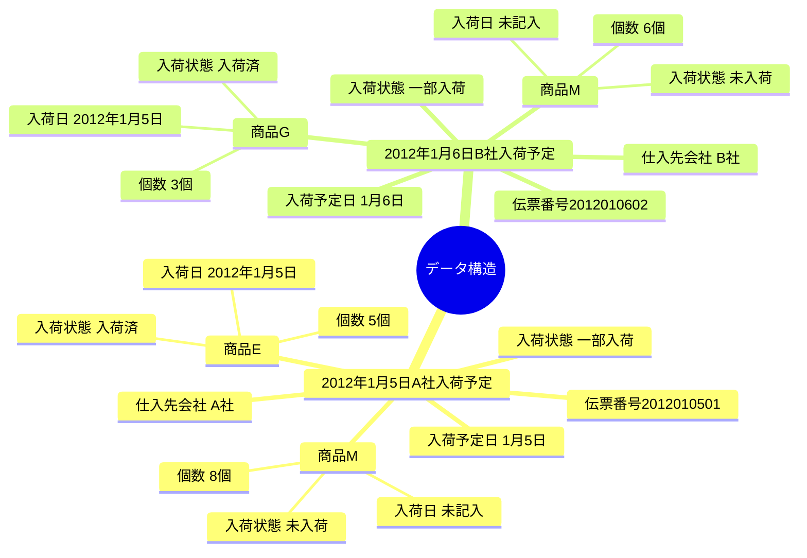
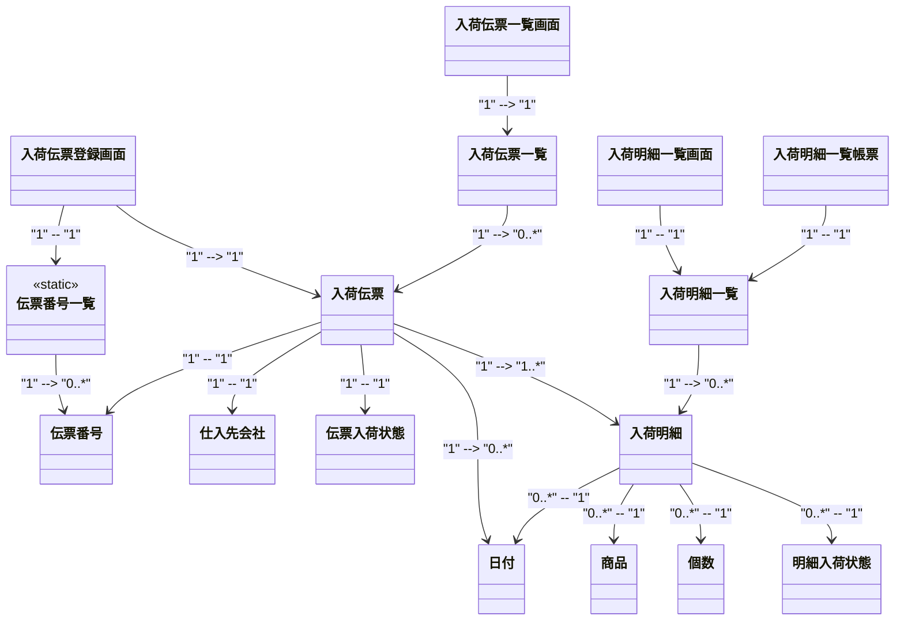
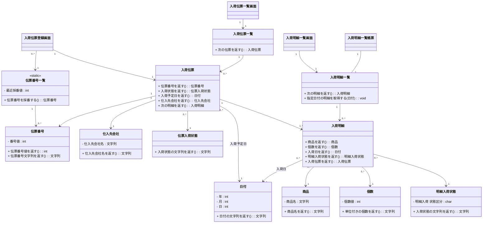
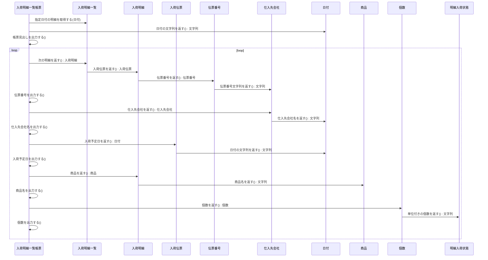

### 実際の業務に近い形で考えてみる

次のような業務シナリオがある場合のモデルを考えてみましょう。

入荷の予定を記入する伝票がある。入荷予定は以下の情報を持つ。

-   伝票番号
-   入荷予定日
-   仕入元会社(取引先)
-   入荷状態(未入荷/一部入荷/入荷済 のいずれか)
-   複数の商品の明細(商品名、個数)

商品それぞれが入荷した場合のために次の情報も必要となる。

-   入荷日
-   入荷状態(未入荷/入荷済)

上記は、商品ごとに分納が可能である。(商品Aは届いたが、商品Bは未入荷)  
その上で次の機能が必要となる。

-   全入荷伝票を検索・一覧表示する画面機能
-   入荷伝票を登録するための画面機能
-   ある日に届いた商品の全明細を表示する画面機能
-   ある日に届いた商品の全明細を表示する帳票機能

上記前提で次のものを記述しなさい。

1.  分析クラス図
2.  設計クラス図
3.  ある日に届いた商品の全明細を表示する帳票機能のシーケンス図

ただし、画面あるいは帳票の機能部分はそれぞれ一つのクラスとして省略設計して構わない。

### オブジェクト図

何はともあれ業務分析はオブジェクト図からです。  
オブジェクト図を描く時のコツは、複数あり得るオブジェクトは必ず複数描くことです。以下の例で言えば、

-   入荷伝票
-   商品

がそれです。  

### 分析クラス図

続いて、クラス名だけのクラス図を描いてみます。[クラスにするもの](4_%20クラスにするもの.md)の説明を参考にして、

-   入荷明細クラス

を忘れないように定義します。分析をする際に見落としがちな点は次です。

1.  採番する際に伝票番号一覧が必要となる
2.  伝票入荷状態と明細入荷状態は異なるクラスである
3.  入荷明細一覧画面は入荷伝票ではなく入荷明細一覧を扱う

特に3は大切です。入荷明細一覧画面は入荷伝票が何であるか関係なく入荷明細を一覧表示する必要があります。入荷明細一覧クラスが無いと、一覧というデータ構造(同じオブジェクトが複数ある形)に対する処理が複数箇所に分散して実装されてしまい保守性が下がります。  
尚、図中に青色を付けてあるのが画面・帳票機能のクラスです。  

### 設計クラス図

続いて属性と処理を記述し、分析クラス図を洗練して設計クラス図を仕上げます。  
尚、次のような帳票を出力する前提で処理を定義しました。

**2012年02月15日入荷の明細一覧**

| 伝票番号 | 仕入先会社 | 入荷予定日 | 商品 | 数量 |
|---:|---:|---:|---:|---:|
| 21200015 | A社 | 2012年02月12日 | 商品M | 10個 |
| 21200015 | A社 | 2012年02月12日 | 商品P | 25個 |
| 21200037 | B社 | 2012年02月14日 | 商品PU | 12個 |
| 21200046 | C社 | 2012年02月15日 | 商品X | 120個 |
| ... | | | | |

下の図が設計クラス図です。分析クラス図を描く段階で一覧系のクラスさえ見逃さなければそれほど難しくないことが判ると思います。  

いくつかポイントを挙げます。  

-   入荷伝票クラスと入荷明細一覧クラスの「次の明細を返す」

上記は、一覧系のクラスに必ず必要なメソッドです。Gofのデザインパターンの中の「Iterator(イテレータ)パターン」と同様です。※

-   伝票番号一覧クラスの「最近採番値」

上記は、直近の伝票番号を記録するための属性です。

-   日付クラスの「日付の文字列を返す」

上記は、"2012年03月02日"というような文字列を返すメソッドです。帳票だけではなく、画面やバッチ機能でも利用します。

-   個数クラスの「単位付き個数を返す」

上記は、"123個"というような文字列を返すメソッドです。帳票だけではなく、画面やバッチ機能でも利用します。

※Iteratorパターンには他に、

-   次の明細は存在するか

というメソッドが必要ですが、ここでは省略しています。

### ある日に届いた商品の全明細を表示する帳票機能のシーケンス図

設計クラス図で定義したメソッドを組み合わせてシーケンス図にします。  
ループしながら入荷明細を取得して、それぞれの値を出力する動きになります。  

慣れないうちは、シーケンス図を描きながら設計クラス図を考えても構いません。両者を行ったり来たりしながら仕上げていきます。  
慣れてくれば、クラス図に定義したメソッドに不足が無いのかをシーケンス図を使って確認するような作業になっていきます。  
つまり、シーケンス図はクラス図の作成や説明を補足する意味合いが強いため、全てのシーケンス図を記述する必要は必ずしもありません。

### まとめ

-   業務モデルを作成する際にはまず実例を考える(オブジェクト図)
-   分析段階から一山クラス(一覧系クラス)を忘れない

### コラム

実際の業務のモデルを作成する際も、原則を忘れなければ難しくないことを理解してもらえたのではないかと思います。特に、

-   一山クラス(一覧系クラス)
-   小粒クラス(日付、個数など)

の2つを見逃さなければ、従来から存在する正規化手法の延長線上にあるという考えで概ね間違っていません。  
これまで皆さんが携わってきたシステムを題材にして、分析クラス図を描いてみることをお薦めします。

次: [インタフェースとは何か](12_%20インタフェースとは何か.md)

